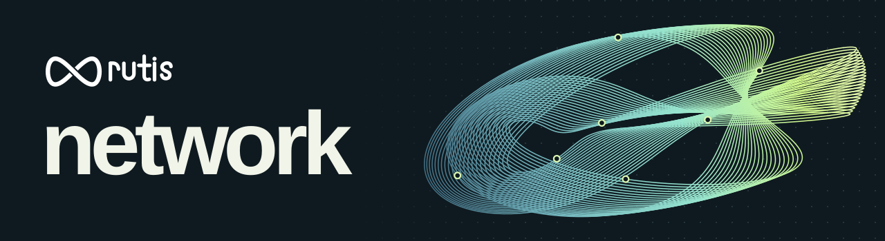

# 

[Get started](#get-started) · [Choose a connection](#choose-a-connection) · [Version tags](https://github.com/arcships/rutis-network/tags) · [中文](README.zh-CN.md)

When you first deploy an application, you may not know every program it will need to work with. Some programs have to stay where the data is collected. Others run only while someone has a browser tab open. Some will be written after the application ships. If adding a capability means editing configuration in several places, those deployment files end up deciding which programs can work together.

rutis-network provides connection plugins for [rutis](https://github.com/arcships/rutis). They let an application establish, manage, and close connections while it runs. An application can start as a single process, then bring in another process in the same container, a remote compute service, or a program in a browser as the work requires. Each part keeps running where it belongs. The application can change which parts work together and grow into a cluster.

## How an application manages connections

Choose a connection plugin and configure which peers may connect. The application can load the plugin at startup or use `rutis/loader` to create and remove plugin instances at runtime. The plugin connects to the peer over the chosen network. Rutis opens a session over that connection, and the application can call the peer’s services by name. [Rutis sessions](https://github.com/arcships/rutis/blob/v0.23.0/docs/guide/nodes.en.md) · [Connection plugin guide](docs/guide/link-plugins.en.md)

Take a group of compute workers that will come online at different times. With Tailscale, you can decide up front which workers may join. Configure the host to discover nodes tagged `tag:rutis-worker` and each worker to accept hosts tagged `tag:rutis-controller`. Once the plugins are installed and the tailnet policy allows access, the host opens a separate session for each new worker it discovers. Renaming a worker preserves its connection. Removing its worker tag closes its session.

The operator maintains one admission rule. The application decides which service should handle each task. It can also turn on discovery when a task begins and remove that group of connections when the task ends. [Configure both ends and manage Tailscale connections](docs/design/04-link-tailscale.en.md)

## Choose a connection

| Your environment | How to connect |
| --- | --- |
| Nodes already share a tailnet | Discover workers by tag or connect to one node by name. [Tailscale](docs/design/04-link-tailscale.en.md) |
| You have SSH access, or both ends can log in to the same VPS | Use the existing SSH endpoint or set up a reverse connection through the VPS. [SSH](docs/design/03-link-ssh.en.md) |
| Part of the application runs in a browser | Make calls in both directions between a page and a native host or another page. [WebRTC](docs/design/08-link-webrtc.en.md) |
| A Go cloud service already exposes a gRPC endpoint | Embed the plugin in the service and reuse its listener. [gRPC](docs/design/07-link-grpc.en.md) |
| An internal service already uses Cloudflare Tunnel | Connect through the existing named tunnel and Cloudflare Access. [Cloudflare Tunnel](docs/design/05-cloudflare-plugin-control.en.md) |
| Each peer identifies the other by Peer ID | Use Go libp2p over a direct QUIC connection or a designated relay. [libp2p](docs/design/09-p2p-plugins.en.md) |
| You want to connect two local hosts or use an existing TCP forward | Connect with mutual TLS. [TCP](docs/design/06-link-tcp-integration.en.md) |

If you don’t know a peer’s address on the local network, use the DNS-SD/mDNS plugin to discover a service once its listener is ready. The connection plugin then verifies the peer and opens the session. [Discover and connect with mutual TLS](discovery/mdns/README.md) · [Discovery and network formation](docs/research/network-groups.en.md)

## Get started

To try rutis locally, run two hosts and call a service in one process from the other. If you already have a tailnet, try adding a worker and then removing it. To connect a different environment, use the connection plugin contract to build an adapter. [Two-host example](docs/design/06-link-tcp-integration.en.md#develop-and-load-the-tcp-plugins) · [Worker discovery](docs/design/04-link-tailscale.en.md#discover-workers-by-tag) · [Connection plugin contract](docs/design/01-link-plugin-contract.en.md)

The plugins target **rutis 0.23.0**, session protocol 5, and plugin API 3. Use matching hosts and language runtimes on both ends. A prebuilt TCP plugin is available for Linux/amd64. [Install the TCP release](docs/guide/link-plugins.en.md#install-the-go-plugins)

To work on the repository, run `make setup` at the root to install development dependencies, then `make check` for formatting, static checks, and fast tests.

Development checks

From the repository root, use Git, Make, Go with toolchain selection enabled, and a supported Node.js version (`^22.18.0 || ^24.11.0 || >=26.0.0`). Run `make setup` after checkout or a lockfile change to install the pinned formatter and the TypeScript packages' development dependencies.

| Command | What it runs |
| --- | --- |
| `make fmt` | Format tracked Go files with gofmt and tracked `.ts`, `.mts`, and `.mjs` files with Prettier. |
| `make fmt-check` | List files that need formatting and exit with an error if any do. Leaves source files untouched. |
| `make test` | Run Go short tests in each module and Vitest unit tests in each TypeScript package. |
| `make check` | Check formatting, run Go vet and strict TypeScript checks, then run the fast tests. |
| `make integration` | Run the TCP host and WebRTC browser/TURN integration suites. Select one with `make integration-tcp` or `make integration-webrtc`. |

The root commands and Linux PR jobs use Go 1.27.4 from [.go-version](.go-version), including its gofmt. To use that toolchain for standalone commands in the same shell, run `export GOTOOLCHAIN="go$(cat .go-version)"` from the repository root. Each module's `go.mod` declares its minimum Go version for consumers. Checks for modules that depend on the TCP bridge use the checked-out bridge in a temporary Go workspace. For a single job, run e.g. `make go-check GO_MODULES=link/ssh` or `make typecheck ts-test TS_PACKAGES=link/webrtc/web`. Both packages provide `npm run test:delivery` for development reload and tarball installation.

After `make setup`, run `link/webrtc/web/node_modules/.bin/playwright install --with-deps chromium firefox` on Linux to install the browsers and their system libraries. TCP uses OpenSSL and the locked rutis host. WebRTC starts its own authenticated loopback TURN server. It tests bidirectional RPC over direct ICE and forced relay, loss and recovery of the relay, and in-flight calls during credential rotation.

On PRs, TCP and WebRTC changes select their respective suites. Changes to the shared Go TCP package, the host fixtures WebRTC imports, or common toolchain and CI configuration select both. Docs-only PRs skip the integration jobs. Every push to `main` runs both suites. [Integration workflow](.github/workflows/integration.yml)

