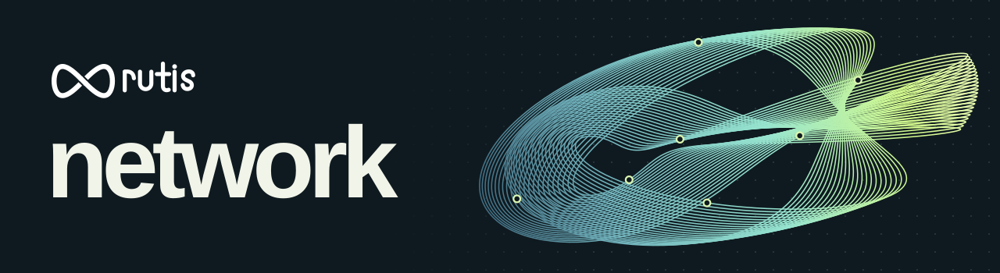

# 

[开始使用](#开始使用) · [选择连接方式](#选择连接方式) · [版本标签](https://github.com/arcships/rutis-network/tags) · [English](README.md)

软件上线时，很难预先列出它以后要和哪些程序一起工作。有些程序必须留在数据产生的现场，有些只在用户打开浏览器时运行，还有些要等到下一次功能迭代才会出现。如果每增加一种能力，都要人先改好几处配置，软件能怎样协作，就受限于部署时已经接好的那几条线。

rutis-network 是 [rutis](https://github.com/arcships/rutis) 的连接插件集合，让软件可以在运行中建立、管理和撤下这些连接。一个应用可以先在单个进程里运行，等任务需要时，再把同一容器里的另一个进程、远端的计算服务或浏览器里的程序接入进来。各部分仍在适合自己的环境里运行，应用可以改变它们的组合。这样，一个程序就有了演进为集群的余地。

## 软件怎样组织这些连接

开发者选择连接插件，配置对端身份和准入规则。应用可以随启动加载插件，也可以在运行中通过 `rutis/loader` 创建或移除连接插件。插件按所选网络的方式接入对端，rutis 将连接建立为会话。会话建立后，应用就能按服务名使用对端提供的能力。[rutis 会话](https://github.com/arcships/rutis/blob/v0.23.0/docs/guide/nodes.md) · [连接插件指南](docs/guide/link-plugins.md)

以 Tailscale 为例。假设一组计算节点会陆续上线，部署时可以只约定谁有资格加入。宿主配置为发现带 `tag:rutis-worker` 标签的节点，每个工作节点配置为只接受带 `tag:rutis-controller` 标签的宿主。双方安装插件、放行相应的网络访问后，新节点上线，宿主就会为它建立独立会话。节点改名，连接会保留。撤掉工作节点的标签，对应会话就会关闭。

这样，部署者维护一条接入规则，应用便能用上之后加入的节点。把哪项任务交给哪个服务，由应用决定。应用也可以在一项任务开始时启用发现，结束时移除这组连接。[Tailscale 双端配置与运行时管理](docs/design/04-link-tailscale.md)

## 选择连接方式

| 你的环境 | 可以怎样接入 |
| --- | --- |
| 节点已经在同一个 Tailscale 网络里 | 按标签自动发现一组节点，或按名称连接指定节点。[Tailscale](docs/design/04-link-tailscale.md) |
| 已有 SSH 入口，或两端都能登录同一台 VPS | 沿用 SSH 入口，或通过 VPS 反向接入。[SSH](docs/design/03-link-ssh.md) |
| 一部分程序运行在浏览器里 | 让网页与原生宿主或另一个网页双向调用服务。[WebRTC](docs/design/08-link-webrtc.md) |
| Go 云服务已经提供 gRPC 接口 | 将插件嵌入云服务，复用已有的监听端口。[gRPC](docs/design/07-link-grpc.md) |
| 内网服务已经使用 Cloudflare Tunnel | 通过已有的命名隧道和 Cloudflare Access 接入。[Cloudflare Tunnel](docs/design/05-cloudflare-plugin-control.md) |
| 两端通过 Peer ID 识别对方 | 使用 Go 版 libp2p，通过 QUIC 直连或指定中继。[libp2p](docs/design/09-p2p-plugins.md) |
| 在本机连接两个宿主，或已有 TCP 转发通道 | 使用双向 TLS 认证建立连接。[TCP](docs/design/06-link-tcp-integration.md) |
| 多个局域网成员需要组成环、树或网状网络 | 从 mDNS 连接说明中选邻居，并为每条边指定唯一拨号方。[Go 组网插件与环形示例](group/peer/README.zh-CN.md) |

在局域网里还不知道对端地址时，可以用 DNS-SD/mDNS 插件发现已就绪的服务入口，再由连接插件验证对端并建立会话。[通过服务发现建立 mTLS 连接](discovery/mdns/README.zh-CN.md) · [发现与组网的服务边界](docs/research/network-groups.md)

## 开始使用

第一次接触 rutis，可以先在本机启动两个宿主，让一个进程调用另一个进程提供的服务。已经有 Tailscale 网络，可以直接试节点自动加入和退出。要接入其他环境，可以按连接插件契约实现自己的适配器。[本机双宿主示例](docs/design/06-link-tcp-integration.md#开发运行和打包加载) · [节点自动发现](docs/design/04-link-tailscale.md#按标签自动发现) · [连接插件契约](docs/design/01-link-plugin-contract.md)

当前插件面向 **rutis 0.23.0**，使用会话协议 5、插件 API 3。两端宿主和语言运行时需要使用匹配版本。Linux/amd64 用户可以直接安装预编译的 TCP 插件。[安装 TCP 发布包](docs/guide/link-plugins.md#安装-go-插件)

参与仓库开发时，在根目录运行 `make setup` 安装开发依赖，再运行 `make check` 完成格式检查、静态检查和快速测试。

开发检查

在仓库根目录使用 Git、Make、支持自动选择工具链的 Go，以及受支持的 Node.js 版本（`^22.18.0 || ^24.11.0 || >=26.0.0`）。首次检出或锁文件变更后运行 `make setup`，按锁文件安装格式化工具和各 TypeScript 工程的开发依赖。

| 命令 | 检查内容 |
| --- | --- |
| `make fmt` | 用 gofmt 格式化 Git 跟踪的 Go 文件，用 Prettier 格式化 Git 跟踪的 `.ts`、`.mts` 和 `.mjs` 文件。 |
| `make fmt-check` | 列出需要格式化的文件，有差异时以非零状态退出，源文件保持原样。 |
| `make test` | 逐模块运行 Go 短测试，逐 TypeScript 工程运行 Vitest 单测。 |
| `make check` | 依次执行格式检查、Go vet、严格 TypeScript 类型检查和快速测试。 |
| `make integration` | 运行 TCP 真实宿主和 WebRTC 浏览器、TURN 集成测试。设置 `MDNS_TEST_INTERFACE` 会一起运行三宿主 mTLS 环网。在 macOS 上可用 `MDNS_TEST_INTERFACE=lo0 make integration-peer-group` 单独运行环网。 |

根命令和 Linux PR 任务都使用 [.go-version](.go-version) 指定的 Go 1.27.4，包括该版本的 gofmt。在仓库根运行 `export GOTOOLCHAIN="go$(cat .go-version)"`，可让当前终端中单独执行的 Go 命令也使用相同版本。各模块的 `go.mod` 声明面向使用者的最低 Go 版本。依赖 TCP bridge 的模块通过临时 Go 工作区使用当前检出的源码。可用 `make go-check GO_MODULES=link/ssh` 或 `make typecheck ts-test TS_PACKAGES=link/webrtc/web` 单独复现一项任务。两个包均可用 `npm run test:delivery` 验证开发重载和打包安装。

在 Linux 上执行 `make setup` 后，运行 `link/webrtc/web/node_modules/.bin/playwright install --with-deps chromium firefox` 安装浏览器和系统依赖。TCP 使用 OpenSSL 和锁文件指定的 rutis 宿主。WebRTC 测试会启动带认证的回环 TURN 服务器，验证 ICE 直连与强制中继下的双向 RPC、中继断开后的恢复，以及凭据轮换期间的在途调用。

PR 改动 TCP 或 WebRTC 时运行对应套件。改动共享的 Go TCP 包或 WebRTC 引用的宿主夹具时也运行 WebRTC 套件。改动组网、mDNS 或 TCP 时，在 macOS 回环接口运行三宿主环网。公共工具链或 CI 配置变更，以及推送到 `main` 时，运行全部三套。纯文档 PR 跳过集成任务。[集成测试工作流](.github/workflows/integration.yml)

