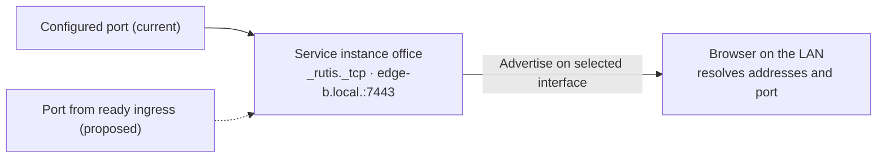

# LAN discovery with Go and DNS-SD/mDNS

[中文](README.zh-CN.md)

Use `go:discover-mdns` to find service instances on one multicast-capable interface or advertise an existing local ingress. A browsing row provides a named read-only rutis service. A group policy can use these observations to select neighbors and give a link plugin a dial target. The link owns admission and session establishment. [Network group design](../../docs/research/network-groups.en.md)

## What gets advertised

**One advertisement describes one DNS-SD service instance, an ingress that a peer on this LAN can try to reach.** For example, the instance named `office` offers `_rutis._tcp` at TCP port `7443` on `edge-b.local.`. The service type tells a client which protocol to use after connecting. The instance name distinguishes several ingresses of the same type. A direct listener or a transparent TCP forwarder can provide this ingress. Both deployments can publish the same advertisement when they expose the same protocol at the same address.



| Browser question | DNS records in this example |
| --- | --- |
| Which instances offer this service? | PTR points from `_rutis._tcp.local.` to `office._rutis._tcp.local.`. |
| Where do I connect to the selected instance? | SRV supplies `edge-b.local.` and port `7443`. A and AAAA supply that host's IPv4 and IPv6 addresses. |

The publishing row configures the type, instance, port and outgoing interface. Bonjour or Avahi supplies the local target host name and addresses. DNS-SD also carries service attributes in TXT records. This plugin supplies an empty set of attributes. The browser adds its receiving interface, its own row ID and an expiry derived from record TTLs to the candidate snapshot. The link verifies peer identity during admission. [DNS-SD instance resolution](https://www.rfc-editor.org/rfc/rfc6763.html#section-5)

**Automatic publication could use the same advertisement.** The publishing row would select the instance name, service type and interface. The component exposing the ingress would report readiness, exposed interface, transport and actual port. The publisher would select an ingress that matches its interface and service type. For example, a loopback backend behind a LAN-facing forwarder would use the forwarder's port. The publisher would announce on readiness, update on port changes and withdraw when the ingress closes or its provider disappears. The provider's plugin name and the mechanism for observing it are local integration details. The current implementation ties registration to publishing-row load and unload. Following ingress state is a proposed extension.

## Run two rows on a LAN

Build from the repository root with Go 1.26 and use rutis-host 0.23.0. Install the binary in the configured Go runtime directory on both hosts.

```sh
mkdir -p plugins/go
(cd discovery/mdns && go build -o ../../plugins/go/discover-mdns ./cmd/discover-mdns)
```

On A, save this as `rutis.json`. Replace `eth0` with A's LAN interface. It must be up and allow mDNS multicast on UDP 5353. The domain defaults to `local.`.

```json
{
  "id": "node-a",
  "runtimes": {
    "go": {
      "dir": "plugins/go"
    }
  },
  "rows": [
    {
      "id": "browse-lan",
      "name": "go:discover-mdns",
      "isolate": {
        "lan-discovery": "management"
      },
      "config": {
        "interface": "eth0",
        "domain": "local.",
        "browse": "_rutis._tcp",
        "service": "lan-discovery"
      }
    }
  ]
}
```

On B, use the same Go runtime directory and add this row to its `rows`. Select B's LAN interface and the port of an ingress already reachable there. The publisher uses the system responder's addresses for the local host. Start each host with `rutis-host run rutis.json`.

```json
{
  "id": "announce-ingress",
  "name": "go:discover-mdns",
  "config": {
    "interface": "eth0",
    "publish": {
      "type": "_rutis._tcp",
      "instance": "node-b",
      "port": 7443
    }
  }
}
```

Publishing supports macOS and Linux on amd64 and arm64. macOS supplies Bonjour. On Linux, run Avahi and install its DNS-SD compatibility library (`libavahi-compat-libdnssd1` on Debian/Ubuntu). Only publishing loads that library. The row waits for registration and fails if the responder assigns a different instance name. Unloading it withdraws the registration. Reload the row after a responder failure.

Each row browses one type or publishes one instance, and can do both. Use another row and service name for another interface. Types use the form `_name._tcp` or `_name._udp`. The instance is a single UTF-8 label of up to 63 bytes and may include spaces or dots. The host running the ingress determines when to enable or unload its publishing row.

## Consume the candidate service

Give a consuming row `"inject": ["lan-discovery"]` and `"isolate": {"lan-discovery": "management"}` to match A. A Go consumer can import `github.com/arcships/rutis-network/discovery/mdns` and use the following in its `Apply` function. Implement `updateNeighbors` with the consumer's own selection policy.

```go
var discovery struct {
    Snapshot      func(context.Context) (mdns.Snapshot, error)
    WaitForChange func(context.Context, string) (mdns.Snapshot, error)
}
if err := row.Use("lan-discovery", &discovery); err != nil {
    return err
}
row.Go(func(ctx context.Context) error {
    state, err := discovery.Snapshot(ctx)
    for err == nil {
        // updateNeighbors replaces the consumer's local view.
        updateNeighbors(state.Candidates)
        state, err = discovery.WaitForChange(ctx, state.Cursor)
    }
    return err
})
return nil
```

Both methods return the latest full view. An empty list is meaningful. An unknown or previous-run cursor returns immediately. Waiting on the current cursor ends on an update or cancellation. A TTL refresh can advance the cursor for the same instance.

```json
{
  "cursor": "sample/2",
  "candidates": [{
    "source": "browse-lan", "interface": "eth0", "domain": "local.",
    "serviceType": "_rutis._tcp", "instance": "node-b", "transport": "tcp",
    "addresses": ["192.0.2.8", "fe80::8%eth0"], "port": 7443,
    "expiresAt": "2026-11-27T08:02:00Z"
  }]
}
```

Key candidates by `source` (the browsing row ID), `interface`, `domain`, `serviceType` and `instance`. `expiresAt` is the earliest expiry among the PTR, SRV and addresses in this view. The next snapshot can retain an instance with fewer addresses. TCP/UDP, port and addresses come from DNS. A caller should check scope, expiry and its own allowed address ranges before handing a target to a link. Supply the expected peer identity separately from local policy.

## Verify

Run in `discovery/mdns`. The live test needs `rutis-host` 0.23.0 on `PATH` or `RUTIS_HOST` set to its executable. Select an interface on which the system responder advertises services. `lo0` works on macOS. On Linux, select an interface enabled in Avahi.

```sh
go test -race ./...
go vet ./...
MDNS_TEST_INTERFACE=lo0 go test -race -count=1 -run TestLiveRows ./...
```

The live test loads separate browsing and publishing rows, waits for the resolved candidate and unloads the publisher to verify withdrawal. Deterministic tests cover split DNS replies, individual TTL expiry, cache flushes, goodbyes, IPv6 zones and cursor cancellation. [Multicast DNS](https://www.rfc-editor.org/rfc/rfc6762) · [DNS-Based Service Discovery](https://www.rfc-editor.org/rfc/rfc6763)
