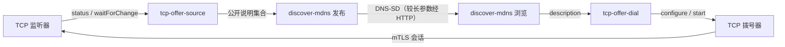

# 用 Go 和 DNS-SD/mDNS 在局域网发现服务

[English](README.md)

`go:discover-mdns` 可以在指定网卡上浏览服务实例，也可以公布本机已有的入口。浏览行提供具名的只读 rutis 服务，组网策略可据此选择邻居、把拨号目标交给 link 插件。准入和会话建立由 link 负责。[组网设计](../../docs/research/network-groups.md)

## 用发现结果建立 mTLS 连接

发布端在监听器就绪后公布实际绑定的端口。拨号端只配置要找的说明 ID、允许的目的地址和预期证书名。两份完整的 rutis-host 配置可以直接作为起点。[发布端配置](example/listener.json) · [拨号端配置](example/dialer.json)



| 配置到哪里 | 配什么 |
| --- | --- |
| 两端各自的 TCP 行 | 本机的 `ca`、`cert`、`key` 和独立的 `controlService`。监听端用 `port: 0` 分配端口，拨号端用 `autoStart: false` 等待发现。 |
| 发布端的 `go:tcp-offer-source` | `listener` 指向 TCP 控制服务，`service` 命名说明来源。配置稳定的 `id`，可附 `serverName` 提示。 |
| 发布端的 `go:discover-mdns` | `interface` 选择网卡，`offers.source` 和行的 `inject` 指向上述来源。监听停止、说明被删除或来源卸载都会撤回公告。 |
| 拨号端的 `go:discover-mdns` | `offers.accept: {"rutis.tcp":[1]}` 选择理解的参数格式，`service` 命名本地发现服务。按需设置 `offers.allowCIDRs`，仅从这些地址读取较长说明。 |
| 拨号端的 `go:tcp-offer-dial` | 注入上述发现服务和独占的拨号控制服务。配置 `id`、本地预期的 `serverName` 及拨号目标的 `allowCIDRs`。存在唯一匹配且目标、证书名提示均通过策略时启动拨号。说明消失、过期或发生歧义时停止该拨号器。 |

例如，浏览结果中的 `description` 为 `{"id":"office","kind":"rutis.tcp","version":1,"params":{"host":"127.0.0.1","port":51827,"serverName":"office.example"}}`。TCP 使用 `params.port` 拨号，候选外层的 `port` 属于提供说明的 HTTP 服务。示例只接受 IP 字面量，回环目标只在回环网卡上接受。CA、证书和私钥由两端从本机配置读取。

从仓库根目录构建两个 Go 插件，将可执行文件放入两端清单的 Go 运行时目录。示例使用 macOS 的 `lo0`，可在同一台机器上启动两个 rutis host，分别运行一份清单。将证书路径换为本机路径，服务端证书应含预期的 DNS 名。在两个独立的项目目录分别执行 `rutis-host run listener.json` 和 `rutis-host run dialer.json`。当前 TCP 监听器绑定回环地址。跨机器使用转发时，应由拥有转发入口的插件在就绪后公布对端可达的地址和端口。

```sh
mkdir -p plugins/go
(cd discovery/mdns && go build -o ../../plugins/go/discover-mdns ./cmd/discover-mdns)
(cd link/tcp && go build -o ../../plugins/go/link-tcp ./cmd/link-tcp)
```

集成其他协议时，实现本地说明来源的 `snapshot()` 和 `waitForChange(cursor)`。两者均返回 `{"cursor":"…","offers":[…]}`，其中 `offers: []` 表示撤回全部说明。如果缺少 `offers` 或它的值为 `null`，发布端会保留上次接受的说明并重新读取快照。一行订阅一个来源，每份快照最多 128 条，单条 `params` 为不超过 64 KiB 的公开 JSON 对象。新的协议只需提供两端的字段映射。mDNS 保留类型、版本及参数，浏览和 HTTP 外取都按观察到的网卡执行。接收方校验参数摘要，链接器根据本地信任配置验证对端身份。[通用连接说明设计](../../docs/design/connection-descriptions.md)

发布端在所选网卡可用的 IPv4、IPv6 地址族上用同一端口提供长说明。如需绑定单一地址，可在发布端设置 `offers.listenIP`。浏览端会在三秒总期限内尝试其他获准地址。只要实际提供说明的地址继续有效，新增地址时就能继续使用已校验的说明。

从仓库根目录运行下面的端到端测试。它临时签发两张不同的证书，启动两端，验证发现、远程 RPC、无客户端证书时拒绝握手，以及来源卸载后的撤回。

```sh
npm ci --prefix link/tcp/node
MDNS_TEST_INTERFACE=lo0 node --test discovery/mdns/test/hosts.test.mjs
```

## 普通 DNS-SD 入口

**一条公告描述一个 DNS-SD 服务实例，也就是其他节点在这条局域网上可以尝试连接的一个入口。** 例如，“名叫 `office` 的实例提供 `_rutis._tcp` 服务，目标是 `edge-b.local.` 的 TCP 端口 `7443`。”服务类型描述客户端连上后应使用的协议，实例名让客户端区分同一类型的多个入口。直接监听和透明 TCP 转发都可以提供这个入口。只要对外提供相同协议和地址，两种部署就可以发布相同内容。


| 浏览者想知道什么 | 示例中的 DNS 记录 |
| --- | --- |
| 哪些实例提供这个服务？ | PTR 将 `_rutis._tcp.local.` 指向 `office._rutis._tcp.local.`。 |
| 选中这个实例后连到哪里？ | SRV 给出 `edge-b.local.` 和端口 `7443`。A、AAAA 给出该主机的 IPv4、IPv6 地址。 |

现有发布行配置服务类型、实例名、端口和发布网卡。系统 Bonjour 或 Avahi 提供本机的目标主机名及地址。DNS-SD 还支持用 TXT 记录附带服务属性，普通入口发布的属性集为空。浏览者在本机补上接收网卡、浏览行 ID 和根据记录 TTL 算出的过期时间，再交付候选快照。对端身份由建连时的准入流程验证。[DNS-SD 实例解析](https://www.rfc-editor.org/rfc/rfc6763.html#section-5)


## 在同一局域网运行两行配置

在仓库根目录用 Go 1.26 构建，两端使用 rutis-host 0.23.0。把二进制放进两端配置的 Go 运行时目录。

```sh
mkdir -p plugins/go
(cd discovery/mdns && go build -o ../../plugins/go/discover-mdns ./cmd/discover-mdns)
```

A 的 `rutis.json` 如下。将 `eth0` 换成 A 的局域网网卡。网卡须已启用，网络须允许 UDP 5353 组播。`domain` 默认为 `local.`。

```json
{
  "id": "node-a",
  "runtimes": {
    "go": {
      "dir": "plugins/go"
    }
  },
  "rows": [
    {
      "id": "browse-lan",
      "name": "go:discover-mdns",
      "isolate": {
        "lan-discovery": "management"
      },
      "config": {
        "interface": "eth0",
        "domain": "local.",
        "browse": "_rutis._tcp",
        "service": "lan-discovery"
      }
    }
  ]
}
```

B 配置相同的 Go 运行时目录，在 `rows` 中加入下面这行。将网卡换成 B 的局域网网卡，端口填该网卡上已经可达的入口端口。发布端通过系统服务公布本机地址。在两台主机上分别执行 `rutis-host run rutis.json`。

```json
{
  "id": "announce-ingress",
  "name": "go:discover-mdns",
  "config": {
    "interface": "eth0",
    "publish": {
      "type": "_rutis._tcp",
      "instance": "node-b",
      "port": 7443
    }
  }
}
```

发布支持 amd64 和 arm64 的 macOS、Linux。macOS 自带 Bonjour。Linux 需运行 Avahi 并安装 DNS-SD 兼容库，Debian/Ubuntu 的包名是 `libavahi-compat-libdnssd1`。仅发布时才加载该库。配置行等待注册成功，如果系统因重名而分配其他实例名，本行会报错。卸载行会撤回通告，系统发现服务发生故障后可重新加载行。

每行可浏览一种服务类型、发布一个实例，也可同时浏览和发布。要观察另一张网卡，给它单独配置一行及服务名。类型使用 `_name._tcp` 或 `_name._udp`。实例名是一个不超过 63 字节的 UTF-8 标签，可包含空格和点。入口所在的主机决定何时启用或卸载发布行。

## 在插件里读取候选

消费行声明 `"inject": ["lan-discovery"]` 和 `"isolate": {"lan-discovery": "management"}`，与 A 的浏览行匹配。Go 插件可导入 `github.com/arcships/rutis-network/discovery/mdns`，在 `Apply` 中读取快照。示例中的 `updateNeighbors` 由消费方按自己的选邻策略实现。

```go
var discovery struct {
    Snapshot      func(context.Context) (mdns.Snapshot, error)
    WaitForChange func(context.Context, string) (mdns.Snapshot, error)
}
if err := row.Use("lan-discovery", &discovery); err != nil {
    return err
}
row.Go(func(ctx context.Context) error {
    state, err := discovery.Snapshot(ctx)
    for err == nil {
        // 用最新候选替换消费方的本地视图。
        updateNeighbors(state.Candidates)
        state, err = discovery.WaitForChange(ctx, state.Cursor)
    }
    return err
})
return nil
```

两个方法都返回最新完整快照。空列表表示当前没有候选。传入未知游标或重启前的游标会立即得到当前快照。传入当前游标会等待变化，调用方可取消等待。已有实例刷新 TTL 也可能产生新游标。

```json
{
  "cursor": "sample/2",
  "candidates": [{
    "source": "browse-lan", "interface": "eth0", "domain": "local.",
    "serviceType": "_rutis._tcp", "instance": "node-b", "transport": "tcp",
    "addresses": ["192.0.2.8", "fe80::8%eth0"], "port": 7443,
    "expiresAt": "2026-11-27T08:02:00Z"
  }]
}
```

候选按 `source`（浏览配置行 ID）、`interface`、`domain`、`serviceType` 和 `instance` 区分。`expiresAt` 取本次快照中 PTR、SRV 和地址的最早到期时间。单个地址过期时，下一份快照可能保留该实例的其他地址。TCP/UDP 类型、端口和地址来自 DNS。交给 link 前，消费方需核对作用域、有效期及本地允许的地址范围，预期对端身份由本地策略另行提供。

## 验证

在 `discovery/mdns` 下执行。实网测试需要 `PATH` 中有 0.23.0 的 `rutis-host`，或将 `RUTIS_HOST` 设为该可执行文件路径。选择系统发现服务允许发布的网卡。macOS 可用 `lo0`，Linux 选用 Avahi 已启用的网卡。

```sh
go test -race ./...
go vet ./...
MDNS_TEST_INTERFACE=lo0 go test -race -count=1 -run TestLive ./...
```

实网测试分别加载浏览行和发布行，等到候选解析成功后卸载发布行，验证候选随之消失。独立的单元测试覆盖分包解析、各记录单独过期、缓存刷新与撤回、IPv6 网卡作用域和游标等待取消。[mDNS](https://www.rfc-editor.org/rfc/rfc6762) · [DNS-SD](https://www.rfc-editor.org/rfc/rfc6763)
