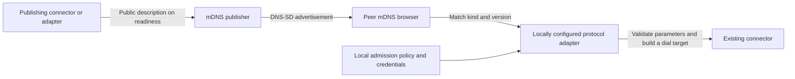

# Discover public connector parameters over mDNS

[中文](connection-descriptions.md) · [Current Go mDNS plugin](../../discovery/mdns/README.md)

**Design proposal.** Discover a **public connection description**. A connector or adapter on the publishing side supplies the public parameters a peer needs to dial. An adapter for the same protocol on the receiving side interprets them. The mDNS plugin transports descriptions with a type and version. PR #24 currently implements ordinary DNS-SD endpoint discovery. This document specifies the proposed extension.

## What a description represents

An SSH publisher knows that a peer reaches a bastion first, then connects to a target from the bastion. It could publish this description.

```json
{
  "id": "office-ssh",
  "kind": "rutis.ssh",
  "version": 1,
  "params": {
    "sshAddress": "bastion.example:22",
    "targetAddress": "127.0.0.1:7443"
  }
}
```

Within one publisher and scope, `id` names a connection option that can be updated or withdrawn independently. `kind` and `version` identify the public protocol and its parameter schema across runtime languages and row names. The protocol defines the JSON object in `params`. Here, the SSH adapter interprets `127.0.0.1` from the bastion's side. One host can publish separate descriptions for SSH, gRPC and other paths. A Go transport can preserve the parameter bytes with `json.RawMessage` and leave typed decoding to the protocol adapter.



## Coverage of the seven connectors on main

These are proposed mappings to the linked implementations. Publishers select public fields explicitly. Receivers construct a dial target from fields their adapter understands.

| Description kind | Public dial information | Supplied or verified by the recipient |
| --- | --- | --- |
| [`rutis.tcp`](../../link/tcp/config.go) | Reachable `host` and `port`, optionally a TLS server name hint. For a forwarded loopback listener, use the exposed ingress. | Permitted address ranges, expected certificate identity, CA and client key pair. |
| [`rutis.grpc`](../../link/grpc/client.go) | Tunnel RPC `address` and optional `serverName` hint. The address can point to a cloud plugin. | Trusted server identity, CA and client key pair. |
| [`rutis.ssh`](../../link/ssh/config.go) | `sshAddress` plus the `targetAddress` reached from that bastion. A ready reverse tunnel can publish its actual allocated port on the bastion. | Allowed bastion and forwarding target, account, known_hosts, identity file and inner TLS configuration. |
| [`rutis.cloudflare-access`](../../link/cloudflared/config.go) | Public Access application `hostname`, optionally an inner TLS server name hint. | Map the authorized hostname to a local profile, forwarding port and Access credentials. The deployment holds the tunnel token. |
| [`rutis.tailscale`](../../link/tailscale/plugin.go) | A tailnet address and port for a specific node. A publisher can explicitly offer a group selector with `tag` and port instead. | Select a trusted tailnet, verify node and tag within it and apply local ACLs and admission policy. |
| [`rutis.libp2p`](../../link/libp2p/config.go) | Full `dial` multiaddr including the destination Peer ID and, for a relay, its Peer ID and the `/p2p-circuit/` path. | Allowed peer identity and local private key. |
| [`rutis.webrtc`](../../link/webrtc/control.go) | A signaling provider identifier approved for publication, such as its public HTTPS URL. Include `pairId` only when it is public and possession grants no authority. | Map the identifier to a trusted local `signalingService`. Pair authorization, SDP, ICE and temporary TURN credentials belong to the signaling exchange. [HTTP signaling implementation](../../link/webrtc/http.go) |

The LAN of publication determines **who can discover the description**. The dial path can traverse a bastion, a tailnet, a relay or the public internet. Advertised identities and names are hints. The recipient matches allowed kinds, versions, paths and expected identities before choosing credentials. Private keys, tokens, configuration file paths and injected service names stay with their respective hosts.

## Endpoints that require certificates

The protocol adapter interprets certificate requirements. The proposed `rutis.tcp` and `rutis.grpc` v1 kinds map to the existing mutual TLS (mTLS) connectors. Their kind and version already tell the recipient to present a client certificate. A protocol supporting several authentication modes can declare the required mode in its own `params`. The mDNS envelope stays the same. [TCP implementation](../../link/tcp/adapter.go) · [gRPC implementation](../../link/grpc/client.go)

For example, a `rutis.grpc` v1 description can advertise `192.0.2.8:7443` with the hint `serverName=office.example`. The recipient first confirms that local policy expects `office.example`, then selects the CA, client certificate and private key configured locally for that service. A client missing a certificate can show “discovered, client certificate required” and skip dialing. During the handshake each side presents its certificate chain and verifies the other side. Private keys stay with their holders. [TLS service identity verification](https://www.rfc-editor.org/rfc/rfc9525.html#section-6.1.1) · [TLS certificate exchange](https://www.rfc-editor.org/rfc/rfc8446.html#section-4.4.2)

Provision trust roots and obtain client certificates through trusted deployment configuration or an authenticated enrollment flow. A public CA or fingerprint in an advertisement can serve only as a hint to match an existing trust record. If an advertisement omits authentication fields, the adapter still enforces the certificate checks required by the protocol and local policy.

## DNS-SD representation

In the proposed generic mode each description has one `_rutis-link._tcp.local.` instance. Instances on the same publishing interface can share a read-only HTTP description service. SRV points to that real service, for example `edge-b.local.:8765`. Both SSH destinations in the example belong to the description. The generic mode requires this HTTP endpoint. Existing native DNS-SD services continue to advertise their own endpoints.

- Common TXT fields are `txtvers=1`, `id`, `kind`, `v` (parameter schema version) and `rev`. The revision is the hexadecimal SHA-256 digest of the exact UTF-8 JSON parameter bytes being transported. Short parameters travel in a single TXT item `p=<JSON>`.
- The proposed v1 inline budget allows 255 bytes per item and 400 bytes for the whole TXT including length bytes. If either limit would be exceeded, omit `p`. The browser retrieves the same bytes at the fixed path `/v1/offers/{id}/{rev}` on the SRV endpoint resolved on that interface. New connector kinds and long relay paths use the same transport rules. [DNS-SD TXT format and sizing](https://www.rfc-editor.org/rfc/rfc6763.html#section-6.2)
- Match a locally supported kind and version before fetching. Use a short alphanumeric, hyphen or underscore identifier for `id`, unique on its HTTP endpoint. Reject a common header that exceeds the budget even with `p` omitted. Restrict retrieval to the observed interface and locally permitted resolved address, disable redirects, bound the response size and send no credentials. Verify the digest in both modes. Bound the lifetime by the earliest expiry of the PTR, SRV, TXT and address records used. Discard stale results after a TXT revision change, record expiry or withdrawal. The digest identifies a revision. The connector verifies the peer's identity.

## Local lifecycle

Each publishing row selects an interface and local description sources. A source can be a connector, an adapter or an application plugin that owns the ingress. It exposes its full set of desired descriptions through `snapshot()` and `waitForChange(cursor)`. The source constructs `params` from protocol-specific public fields, including the actual target once the service is ready.

The publisher compares snapshots by source and `id`. It registers new entries, updates TXT and the corresponding parameter revision on a change and withdraws entries when they disappear or their source unloads. A restarted publishing row reads a fresh snapshot. After a host loss, browsers expire descriptions according to DNS record TTLs. A browser distinguishes identical instance names by observation interface, source and DNS instance. It hands `kind/version/params` to a local adapter supporting that version. Adding a connector requires only the producing and consuming parameter mappings.

## Transport checks

An independent macOS Bonjour experiment used a loopback interface. The two-address SSH example above (68 parameter bytes) and an unfamiliar kind with a nested object both round-tripped inline in TXT. A 393-byte WebRTC test payload round-tripped through the temporary HTTP endpoint resolved from SRV and passed digest verification. These checks exercised description transport. Generic mode in the Go plugin, per-connector mappings and actual dials remain to be implemented and verified.
