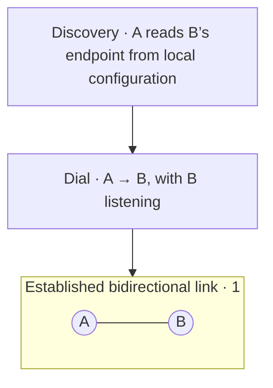
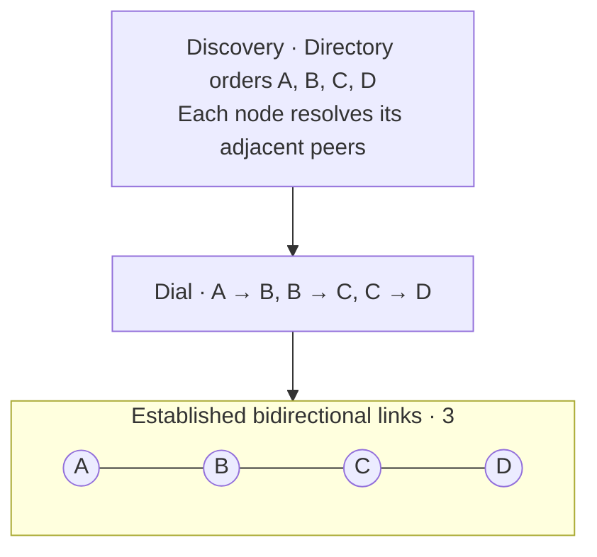
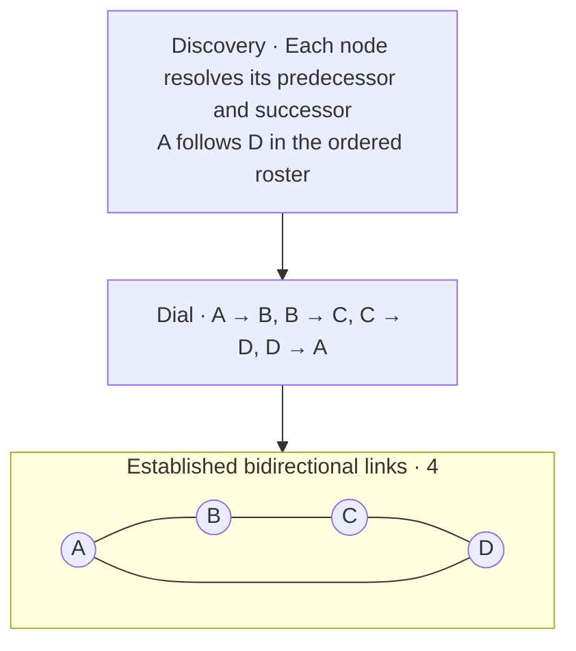
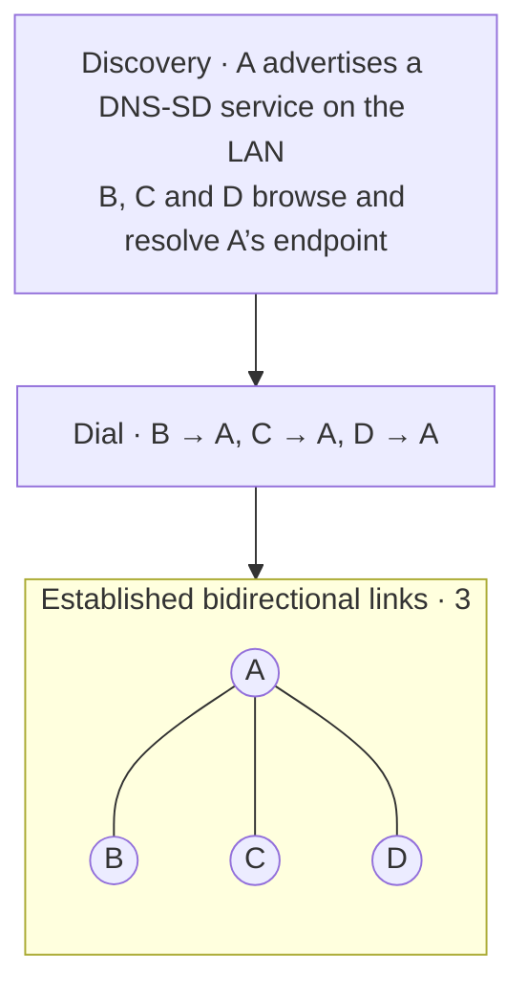
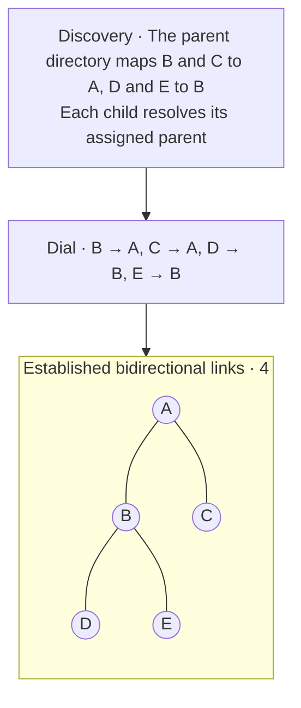
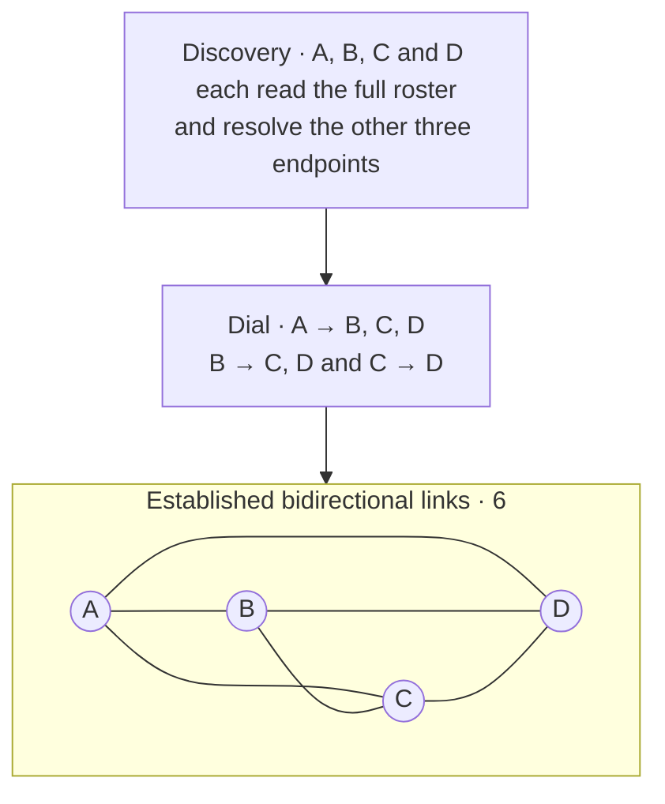
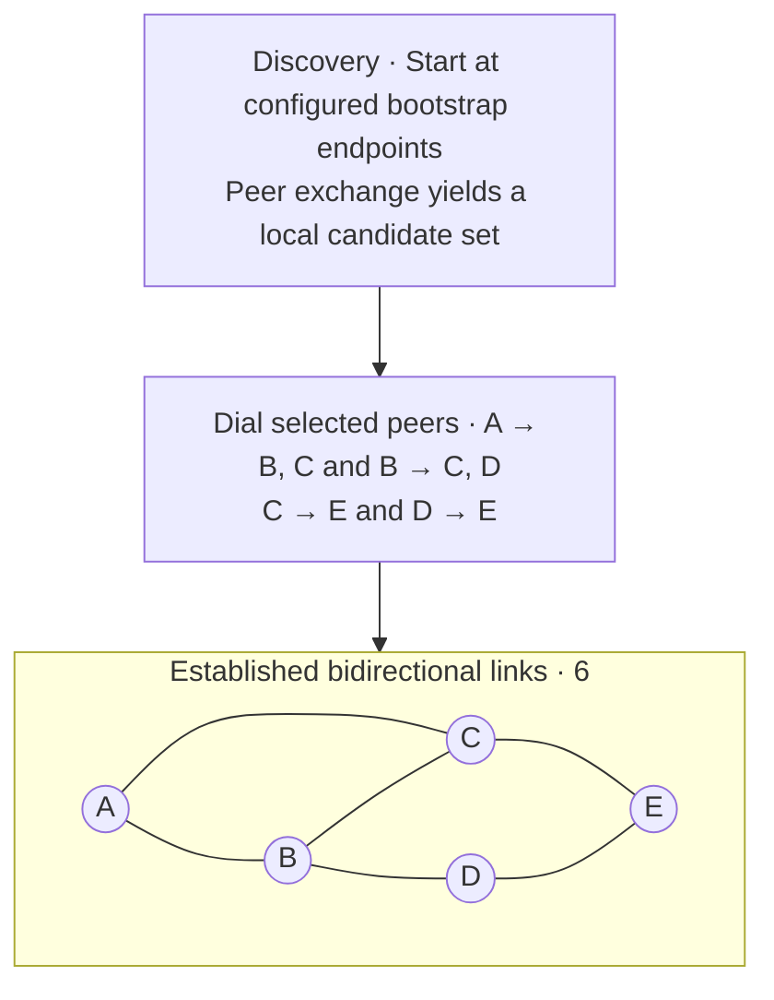
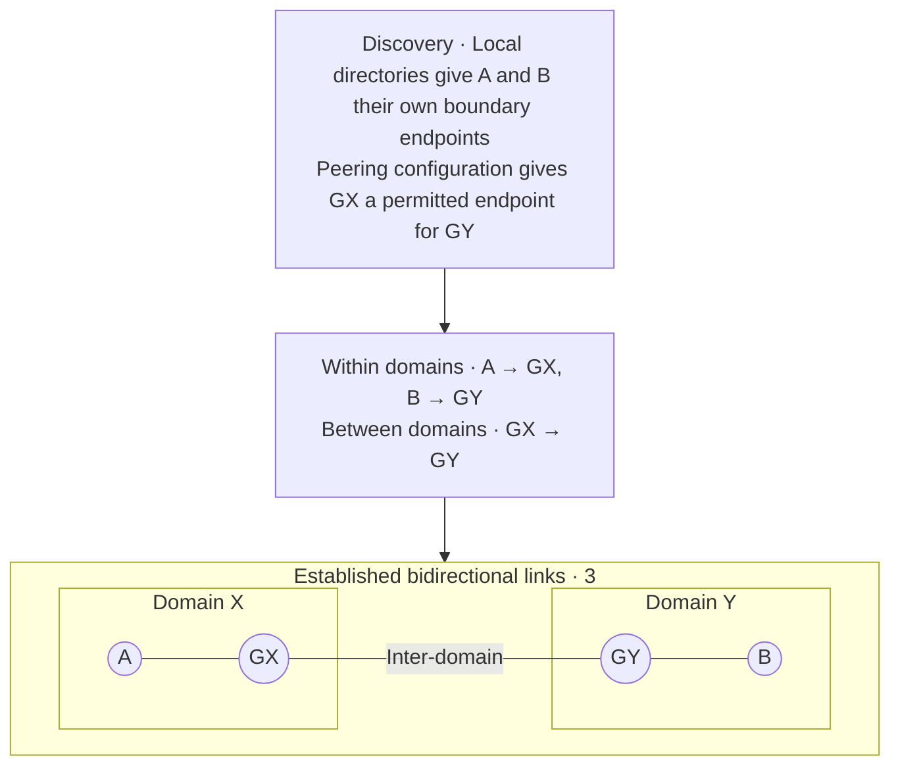
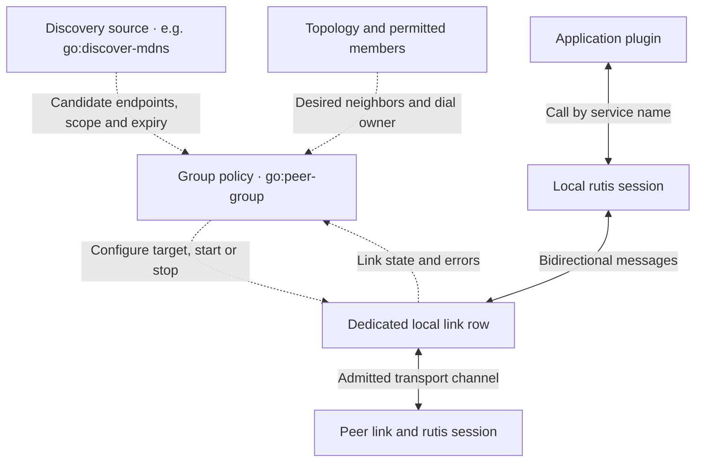

# Discovery, network formation and the boundary between network and application services

[中文](network-groups.md)

A device may be the only party able to dial, yet the cloud can call it back over the established connection. Other networks have a genuinely one-way channel, or endpoints that will never be online together. Three questions help distinguish these cases. Who can discover whom? What does a message address? Under what conditions can the parties complete an exchange?

This research uses rutis 0.23.0 as its baseline. Here the network layer includes the discovery, reachability and transport plugins in `rutis-network`, a broader scope than IP. Existing implementations illustrate the boundary. Optional services and proposed experiments describe the remaining design space.

The [network stack survey](network-stacks.en.md) applies these boundaries to IoT, industrial and specialized networks by inspecting the IP interface, duplex stream, attributes, short messages or one-way observations a device exposes.

For cross-domain trust, authorization during a partition and path recovery, see [security, reliability and trustworthiness](network-assurance.en.md).

## 1. What rutis already provides

- A link can hand an admitted, reliable, ordered, bidirectional message channel to `rutis/sessions.open(far)`. The link row owns admission, framing and the connection lifecycle. Rutis learns the peer's self-declared ID from the session Hello and manages remote plugins, service scope and online events. A service can already reach a third node through an intermediate host. Providers with the same service name in one scope can conflict at registration. [Link plugin contract](../design/01-link-plugin-contract.en.md) · [Connecting rutis nodes](https://github.com/arcships/rutis/blob/v0.23.0/docs/guide/nodes.en.md)
- The Go Tailscale plugin watches the network map visible to its own node, selects peers by tag and maintains connections by stable Tailscale node ID. A rename can preserve a connection. Removing the tag closes it. This observation has a specific source and scope. Applications define tenant, workshop and job-queue membership. [Tailscale implementation and configuration](../design/04-link-tailscale.en.md)
- The Go libp2p plugin supports direct and relayed connections to a specified peer. The Go gRPC plugin connects a device to a plugin embedded in a cloud service. In the gRPC example the transport carries the request, and the cloud application's scheduler handles the job. Changing the path to the cloud leaves the scheduler in charge of that decision. [libp2p plugin](../design/09-p2p-plugins.en.md) · [gRPC implementation and design scope](../design/07-link-grpc.en.md)

## 2. Deriving capabilities from network types

Topology, administrative boundaries and availability over time are independent dimensions. A domain may use an internal mesh and connect to another domain through one boundary endpoint over an intermittent link.

| Network type | What a plugin can observe from its location | Capability implied |
| --- | --- | --- |
| LAN or proximity network | Service instances appear and disappear on the local link. Addresses can change. | Browse by type, resolve addresses and expire records. Check admission when connecting. [DNS-SD](https://datatracker.ietf.org/doc/html/rfc6763) |
| Internet or cellular star | Devices can dial out and the hub can call back. A path between devices needs its own check. | A known ingress address, calls over an established connection, and introductions or relaying when required. [gRPC example](../guide/link-plugins.en.md) |
| Tree or hierarchy | A parent can advertise a subtree ingress while a directory inside the subtree resolves individual nodes. | Address a domain or prefix, select a next hop or delegate to a downstream gateway. |
| Enterprise VPN or overlay | A node can participate in several networks, each with its own names, tags and visibility. | Identify the network used for observation and dialing. Reuse its directory and admission policy. [Tailscale plugin](../design/04-link-tailscale.en.md) |
| Cluster service network | A stable service name can represent several interchangeable backends. | Select the service endpoint or enumerate instances. Network reachability and application job requirements offer different selection criteria. [Kubernetes Service](https://kubernetes.io/docs/concepts/services-networking/service/) |
| Peer-to-peer or self-organizing mesh | Nodes know a subset of their neighbors. Several paths may lead to a destination. | Bootstrap, rendezvous, peer discovery and path selection. Hop-by-hop dissemination also needs bounds on scope and duplicate forwarding. [libp2p DHT](https://libp2p.io/docs/kademlia-dht/) |
| Topic network | The publisher knows a topic. The subscribers change over time. | Distribute by subscription and specify scope and delivery guarantees. A plugin can bridge rutis online events to an external topic network. [libp2p Pub/Sub](https://libp2p.io/docs/pubsub/) |
| Independently administered networks or federation | Each domain controls names and admission. An outsider may see only one ingress. | Qualify names by origin, selectively publish and withdraw records, and enforce admission at the boundary. Discovering a record and reaching the service are separate operations. [Cross-link discovery proxy](https://datatracker.ietf.org/doc/html/rfc8766) |
| Intermittent or opportunistic network | A meets B and B later meets C. There may be no instant when all three are online. | Store and forward, apply expiry and record receipt at each hop. The application separately confirms processing. [Bundle Protocol](https://datatracker.ietf.org/doc/html/rfc9171) |
| One-way channel | A receiver hears announcements or data. The channel has no return path. | Expose subscription or reception. Receipts require an independently agreed return path, and live bidirectional RPC requires another channel. |

**The destination shapes the interface.** Unicast addresses one node. Choosing any reachable instance addresses a pool. Broadcast addresses receivers on a link. Multicast and topic delivery address a group or subscription. Collecting replies from the group adds a membership snapshot, a deadline and partial results. Addressing a domain delegates the choice of recipient. Requesting an object by hash allows a verified replica to respond. Addressing an offline recipient separates its identity from delivery time. A membership group, subscriber group, service pool and administrative domain each has its own rules for joining and leaving. [IP multicast](https://datatracker.ietf.org/doc/html/rfc1112) · [Content naming](https://named-data.net/project/archoverview/)

## 3. What an intermediate node does

Consider B on the path `A → B → C`. One machine can perform several roles.

| B's role | B's decision | Consequence for the endpoints |
| --- | --- | --- |
| Bootstrap, rendezvous or directory | Supply initial neighbors, introduce peers or resolve a name to candidate addresses. | A and C may connect directly after the introduction. Candidates still need a connectivity check. [ICE connectivity checks](https://datatracker.ietf.org/doc/html/rfc8445) |
| Bridge, router or relay | A bridge forwards frames between link segments. A router chooses a next hop for a destination. A transparent relay forwards data between two available connections. | When B only forwards, A and C remain the rutis session endpoints. Existing infrastructure can provide IP routing. [libp2p circuit relay](https://libp2p.io/docs/circuit-relay/) |
| Gateway or protocol translator | A gateway is an entrance to or exit from a domain. A router can fill this role. An application gateway can also terminate an external request and make a separate internal call. | Such an application gateway is A's peer. It can expose one interface while keeping C's address and protocol internal. |
| Broker, multicast forwarder or gossip peer | Replicate by subscription, distribution tree or neighbor relationships, respectively. | A sender can address a group or topic. Consumers need to know the scope, duplicate behavior and expiry rules. |
| Mailbox, cache or replica | Hold data for an offline recipient, return a stored copy by content or serve reads while the origin is offline. | Receipt at the intermediary, delivery to the destination and successful application processing each require distinct evidence. |
| Path probe, selector or observer | Test a path from a specific location, compare direct and relayed paths, or switch egress according to configuration. | A failed probe describes that observer's path. Switching paths can require a new session. |

## 4. Network infrastructure and application services

Ask **who can verify the promised outcome**. A link row can report that it admitted a connection to an address at a given time. A durable mailbox can confirm that it stored a message. The order application can confirm that it posted an order. Each receipt has a distinct meaning even when all three components run in one Go process.

**Network policy has an owner of its own.** For example, a link plugin can maintain a channel using an existing Cloudflare Tunnel and its credentials. The operator configures which site uses the tunnel and who manages the Access policy. The order service checks whether the caller may approve an order. A single request can pass through all three decisions. [Cloudflare plugin management boundary](../design/05-cloudflare-plugin-control.en.md)

| Capability | Network infrastructure owns | Application plugin or operator decides |
| --- | --- | --- |
| Discovery and membership | Publish, resolve, observe and withdraw candidate endpoints in a named network. Record source, validity and observation point. | Which devices belong to a site, tenant or fleet, who may assert membership, and whether it survives loss of connectivity. |
| Connecting and forming networks | Connect according to declared peers, tags or topologies. Enforce link admission and handle heartbeat, backoff, release and path state. | Which sites should connect, permitted egresses, cost and resource budgets, and authorization for application methods. |
| Multiple providers | Return matching candidates, optionally select a reachable ingress and report refusals or timeouts. | Select an OCR worker by model version, customer requirements or load. Own queuing, job retries and idempotency. Reconnecting cannot establish whether the previous job ran. |
| Cross-domain gateway | Qualify the source domain, publish or withdraw configured records, enforce boundary admission or forward transparently. | Choose which capabilities to share with each partner. An application gateway enforces method permissions, converts units or filters fields when it terminates a request. |
| Group messaging and fan-out | Optional plugins track subscriptions, bound dissemination and report the delivery status they can establish per destination. | Define alert topics and audiences, fix the membership snapshot, choose all replies or a quorum, handle partial results, and decide whether a duplicate alert takes effect again. |
| Deferred delivery and content distribution | Optional plugins accept, retain or expire data under their stated persistence guarantees, or return verifiable copies. | Set order validity, choose acceptable data versions, confirm consumption and handle duplicate or expired operations. |
| Observability | Identify the observer, time, state and failure cause for a path or queue. | Decide whether a device has stopped production, a job has missed its deadline, or an operator should intervene. |

**Placement follows the guarantee.** An adapter owns admission, I/O, shutdown and status for its link. A directory, rendezvous service, relay, discovery proxy, topic bridge or mailbox is **optional infrastructure for a particular network**. Each can run independently or be injected as an ordinary plugin service. Schedulers, inventory queries, tenant authorization, alerts and business receipts live in application plugins. Rutis already owns service registration, dependency lifecycle and online events once a session opens. [Plugin composition contract D11](../design/01-link-plugin-contract.en.md) · [Connecting rutis nodes](https://github.com/arcships/rutis/blob/v0.23.0/docs/guide/nodes.en.md)

A Go discovery plugin could use its configuration row to choose the network to observe and the local service name to provide. Consumers would declare that service in `Inject`. An authorized management plugin can use `rutis/loader` to add or remove connection rows. Each link row retains ownership of its certificates, tokens and retries. To share a narrow cross-domain interface, a boundary plugin can terminate requests and explicitly export operations. A direct rutis node session trusts the admitted peer. Filtering discovery results alone cannot limit an established session. [Existing management pattern](../design/04-link-tailscale.en.md) · [Host trust boundary](https://github.com/arcships/rutis/blob/v0.23.0/docs/guide/nodes.en.md#security)

## 5. Research questions with observable outcomes

These proposed experiments can use independent Go plugins alongside the existing links.

1. **Proximity discovery.** A discovers B's advertised service, but B currently refuses admission. A should distinguish a valid record from the refused connection attempt. When the record expires, the discovery view removes it. The application still owns its device roster.
2. **Two administrative domains.** Two devices in domain A provide the same service name in their own scopes. A announces a single ingress to domain B. Disconnect the inter-domain path. B can report the failed path and retain its last observation with an expiry. Restore the path, then explicitly withdraw the ingress. B should observe withdrawal while the second service remains private. Use the duplicate service names to test domain scope and verify that external callers can invoke only the methods explicitly exported at the ingress.
3. **Two paths and an in-flight call.** A and C have direct and relayed paths. Cut the direct path after job submission but before the application receipt. The network can report failure and establish another session. The application can look up the job by ID or retry safely. Check path recovery and the actual number of job executions separately.
4. **Asynchronous delivery.** A leaves a message with B and goes offline. C appears the next day. Deliver one valid message and let a second expire. Observe B's durable receipt, delivery to C and the outcome of application processing separately. Check that duplicate delivery does not execute the business operation twice.

## 6. A plugin design for discovery and network formation

### Selecting neighbors by topology

Read the seven topologies and the inter-domain example from top to bottom. The first box shows how neighbors are discovered. In the second, **A → B** means A dials B. Each **undirected line** in the last panel is one bidirectional rutis session established after admission. Discovery may yield more endpoints than the policy selects.

[Point-to-point](#point-to-point) · [Chain](#chain) · [Ring](#ring) · [Star](#star) · [Tree](#tree) · [Full mesh](#full-mesh) · [Partial mesh](#partial-mesh-with-bounded-degree) · [Inter-domain](#inter-domain-connections)

#### Point-to-point

B can have a configured endpoint or resolve to several addresses. A verifies the expected peer and keeps one healthy connection.



#### Chain

Configuration or a membership directory supplies the node order. Interior nodes accept from their predecessor and dial their successor. Losing B–C splits the chain into A–B and C–D.



#### Ring

A ring adds an edge joining the ends of the chain. When membership changes, nodes use the same revision of the ring order to identify their new predecessor and successor.



#### Star

Leaves only need an endpoint for hub A. All three sessions are bidirectional. If B needs to reach C through A, the hub must also provide forwarding.



#### Tree

A is the root. Each non-root node connects to one permitted parent and may accept children. Check levels or ancestry before reparenting to prevent cycles.



#### Full mesh

Keep one connection per member pair. The four nodes share an authorized roster and agree that the lower stable ID dials. This assigns one initiator per edge and produces N(N−1)/2 edges for N members.



#### Partial mesh with bounded degree

Nodes can learn candidates from bootstrap peers and known neighbors, then keep a subset of permitted neighbors. Here each node keeps at most three edges. Even if A learns D’s endpoint, it keeps B and C. Multi-hop communication also requires a connected graph and forwarding.



#### Inter-domain connections

Domains can use any internal topology. A and B belong to different domains, with GX and GY as their respective boundary endpoints. Only GX–GY crosses domains. Route advertisements or gateway rules govern reachable prefixes and exported services. A transparent relay can carry the inter-domain edge. [Intermediate node roles](#3-what-an-intermediate-node-does)



### How discovery, group policy and links fit together

Topology is a policy input to `go:peer-group`. It matches **candidate endpoints with a source and expiry** to **the neighbors this host should maintain**, then hands the dial target to a dedicated link row. A LAN can use DNS-SD/mDNS, a fixed point-to-point link can read configuration and an overlay can use its directory. The same topology can use different discovery sources.



Dotted arrows show discovery, policy and control feedback. Solid arrows trace messages on an established connection. Both `go:discover-mdns` and `go:peer-group` are proposed Go plugins. The existing TCP link accepts a target and performs mTLS admission before handing the channel to `rutis/sessions.open(far)`. [TCP control interface](../design/06-link-tcp-integration.en.md) · [Plugin composition contract D11](../design/01-link-plugin-contract.en.md)

| Component | Responsibility of one configured row | Consumer |
| --- | --- | --- |
| `go:discover-mdns` | Browse DNS-SD services on the specified interface and DNS domain, or advertise a locally configured ingress. Provide a named read-only service such as `lan-discovery`. | A UI can display candidates independently. A group policy can subscribe to the same observations. |
| `go:peer-group` | Declare the intended peers, allowed discovery source and dedicated dialing service. Continuously compare the intent with observed link state and initiate or stop connections as needed. | A management UI can inspect the selection reason, transport state and latest error for each target. Application plugins still use rutis service names. |
| Existing link row | Dial the address, authenticate the expected peer, handle retries and own the session lifecycle. The deployment supplies credentials to this row. | A group row operates only the explicitly injected local control services it exclusively owns. |

### Candidates, targets and link state

A **candidate endpoint** answers “where did I observe this ingress?” The discovery service exposes `snapshot()` and `waitForChange(cursor)`. Both return the latest full snapshot in the same format. Each record includes its source row, interface, DNS domain, service type, instance, transport, resolved addresses and port, and expiry. Key a record by source, interface, domain, service type and instance. A record can have several addresses. Keep addresses scoped to their interface, including the zone of a link-local IPv6 address. Expire individual addresses or the whole entry when the underlying records expire. Full snapshots let slow readers catch up. A restart creates a new cursor. The publishing row advertises its configured ingress and withdraws it on unload. TTL covers abrupt power loss. [DNS-SD](https://www.rfc-editor.org/rfc/rfc6763.html) · [mDNS](https://www.rfc-editor.org/rfc/rfc6762.html)

A **connection target** answers “who is this host allowed to connect to, and which side dials?” Give it a stable local name, candidate matching rules, permitted address ranges, an expected transport identity and a dedicated link control service. Discovery instance names and TXT labels are selection hints. Obtain the expected TLS name from local configuration. Keep the CA and private key in the TCP row. Matching names, addresses or labels are insufficient to merge endpoints across networks into one member. An application that requires authoritative membership can supply its roster as a policy input. A LAN advertisement cannot grant membership.

**Connection state** has three independently observable parts per target. The discovery record can be current, the link can pass local admission and attach, and an application service can become callable. The group row can expose the first two, the chosen address and the last error via `status()` and `waitForChange(cursor)`. Service registration or a successful call supplies evidence for the third. Go's `sessions.open` does not return the rutis ID from the handshake. Advertisements and certificates cannot supply that ID. [TCP status fields](../design/06-link-tcp-integration.en.md)

### Mapping a topology edge to configuration

The first version proposes explicit neighbors. The configuration below expands one edge with A dialing B. For point-to-point it is the whole topology. In a star or tree it can be the uplink to a hub or parent. A complete ring or mesh also needs the membership selection and coordination described above. This proposed configuration for A isolates discovery, status and dialing services in the local management scope.

```json
{
  "rows": [
    {
      "id": "browse-lan",
      "name": "go:discover-mdns",
      "isolate": {"lan-discovery": "management"},
      "config": {"service": "lan-discovery", "interface": "eth0", "domain": "local.", "browse": "_rutis._tcp"}
    },
    {
      "id": "to-b",
      "name": "go:link-tcp-dial",
      "isolate": {"b-link": "management"},
      "config": {"controlService": "b-link", "autoStart": false, "ca": "/etc/rutis/ca.pem", "cert": "/etc/rutis/a.pem", "key": "/etc/rutis/a.key"}
    },
    {
      "id": "local-group",
      "name": "go:peer-group",
      "inject": ["lan-discovery", "b-link"],
      "isolate": {"lan-discovery": "management", "b-link": "management", "group-status": "management"},
      "config": {"source": "lan-discovery", "service": "group-status", "targets": [{"id": "b", "instance": "node-b", "allowedCIDRs": ["192.168.20.0/24"], "servername": "b.example", "link": "b-link"}]}
    }
  ]
}
```

B advertises instance `node-b` and a reachable TCP ingress such as `192.168.20.8:7443` on the designated interface. B verifies A's certificate using mTLS. The existing Go TCP listener binds only to IPv4 loopback, so a cross-host trial needs an ingress that forwards the TCP stream to B's loopback listener. Advertise when the ingress is ready and withdraw when it stops. [Existing listener and forwarding options](../guide/link-plugins.en.md) · [TCP listener restriction](../design/06-link-tcp.en.md)

A validates the source and the resolved IP against its permitted range, then calls `configure({host, port, servername})` and `start()` on `b-link`. Pass the checked IP as `host` and the locally configured name as `servername`. Serialize decisions per target using the latest discovery and link snapshots. Repeated announcements only refresh the expiry. With multiple addresses, keep a healthy path and select a still-valid address after disconnect. The TCP row backs off on transient failures. The group row avoids parallel attempts for the same target. After a service reload, read both snapshots before taking action. Start with one preconfigured dial row per target and validate ordinary cross-host service calls. [Existing TCP configuration and retry behavior](../design/06-link-tcp-integration.en.md)

| Event | Default behavior and acceptance criterion |
| --- | --- |
| Another interface announces the same name, or the resolved IP is outside the permitted range | Dial only candidates on the configured interface and in the permitted range. A valid address with the wrong certificate still fails TCP admission. |
| The advertisement disappears while an established link is healthy | Remove the record and disable automatic retries for the target. The established connection can continue. Stop a pending dial or backoff. After a later disconnect, wait for a fresh record. Verify expiry and connectivity independently. [TCP retry control](../design/06-link-tcp-integration.en.md) |
| The address changes, the interface briefly goes down or the publisher restarts | Keep a healthy connection and update candidates for the next dial. Stop attempts on the old address before selecting another after disconnect. Resolve duplicate or out-of-order notifications against the latest snapshot. |
| Local policy revokes the target or the group row unloads | Immediately stop owned dials and retries, close active links and cancel observations. Other groups and manually configured links continue operating. |

A host can participate in several groups, each with explicit sources, targets and control services. The same discovery interface could later read a static directory. The target model can describe a set of configured neighbors. Define one dial owner per edge before introducing a bounded mesh. Existing Tailscale tag discovery retains its authoritative network map and revocation rules. Across domains, a directory introduces endpoints, a relay forwards along a selected path, a router selects a next hop and a protocol gateway terminates the native protocol and exports a service. Deploy those roles as needed. The LAN group plugin only has to maintain this host's selected edges. [Tailscale tag discovery](../design/04-link-tailscale.en.md) · [libp2p direct and relay paths](../design/09-p2p-plugins.en.md)
