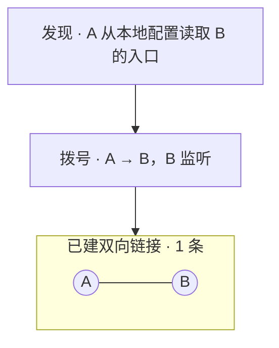
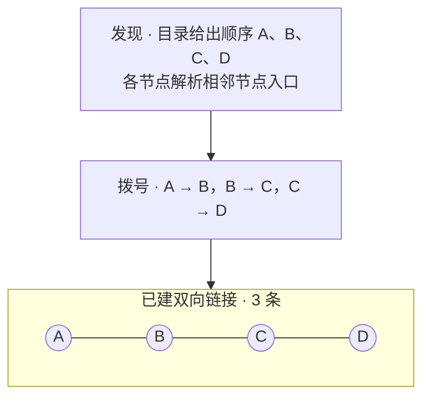
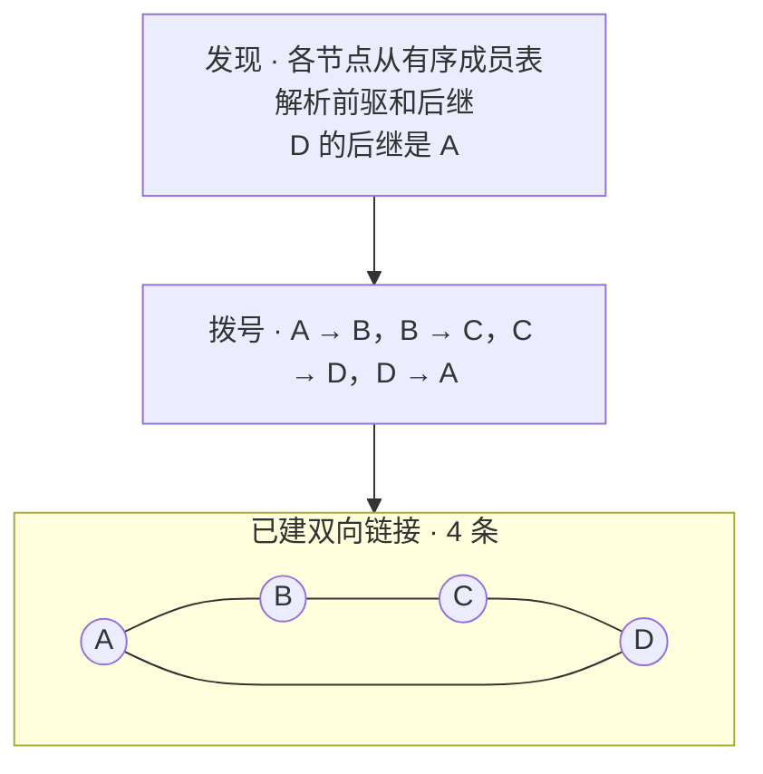
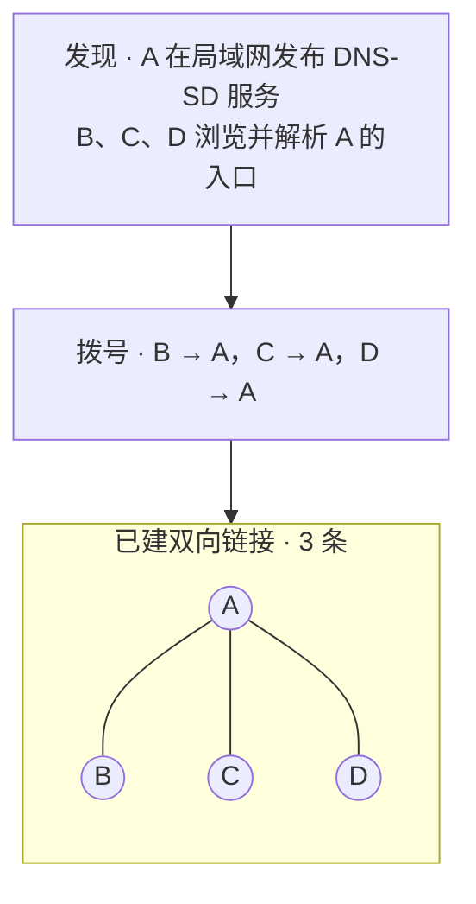
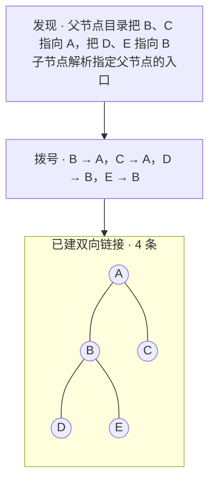
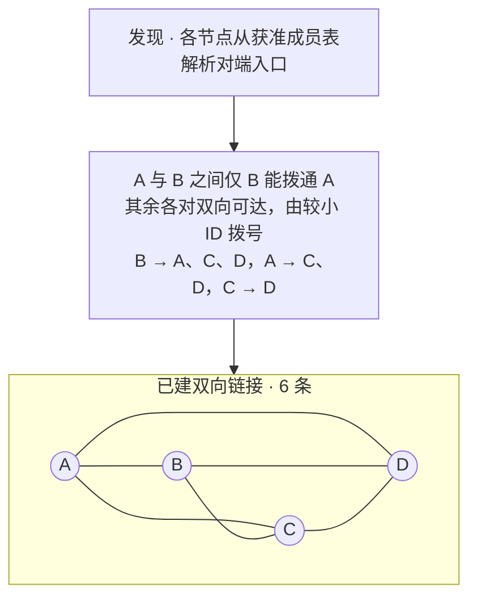
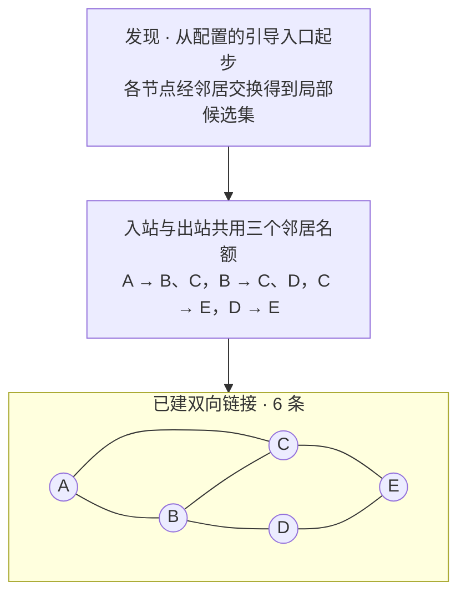
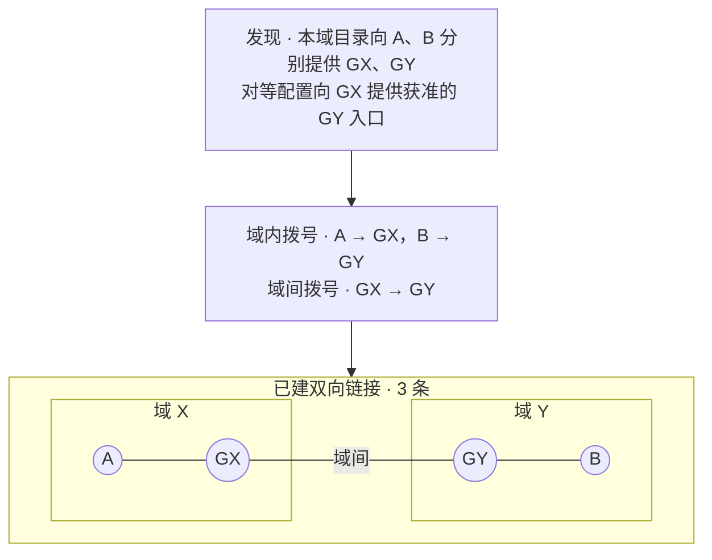
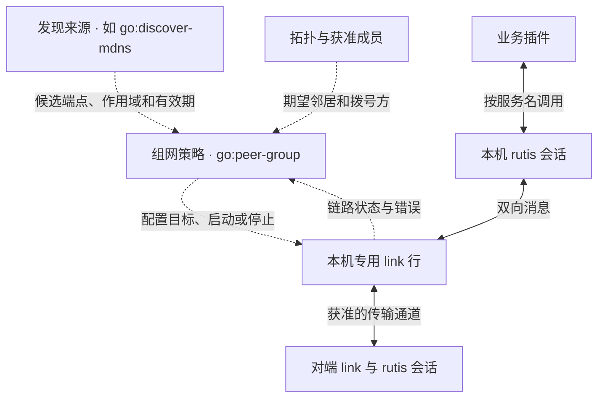

# 发现、组网与跨域互联中的服务边界

[English](network-groups.en.md)

设备只向云端拨号，连接建立后，云端仍可回调设备。这里的“单向”描述谁能发起连接。另一些网络只有真正的单向信道，还有些网络里的双方从未同时在线。讨论群体互联时，先看谁能发现谁、消息发给谁，以及两端在什么条件下能完成一次交互。

本文以 rutis 0.23.0 为基线。“网络层”指 `rutis-network` 中负责发现、可达性和传输的插件，涵盖的范围比 IP 层广。下文用已有实现解释边界，也讨论可单独提供的服务和有待验证的设想。

具体选型见[网络栈调查](network-stacks.md)，按设备交付的 IP 接口、双向流、属性、短报文或单向观测来判断插件边界，包含 IoT、工业现场和专用网络。

跨域信任、失联时的授权和路径恢复见[安全、稳定与可信研究](network-assurance.md)。

## 1. 已有的起点

- 一条获准的可靠、有序、双向消息通道可以交给 `rutis/sessions.open(far)`。链接行负责准入、分帧和连接生命周期。rutis 从会话 Hello 获得对端自报的 ID，管理远端插件、服务作用域和在线事件。服务已经可以经中间宿主抵达第三个节点。同一作用域里的同名服务会发生注册冲突。[链接插件契约](../design/01-link-plugin-contract.md) · [rutis 节点指南](https://github.com/arcships/rutis/blob/v0.23.0/docs/guide/nodes.md)
- Go Tailscale 插件观察本机可见的网络图，按标签筛选节点，按稳定的 Tailscale 节点 ID 维持连接。改名可以保留连接，撤销标签会关闭对应连接。这份观察有明确来源和范围。节点所属租户、车间和任务队列由各自的应用定义。[Tailscale 实现与配置](../design/04-link-tailscale.md)
- Go libp2p 插件支持指定对端的直连和经中继连接。Go gRPC 插件支持设备连到云服务内嵌的插件。gRPC 示例里，设备通过隧道提交任务，云应用自己的调度器决定如何处理任务。换一种到达云端的方式，任务规则仍归同一个应用。[libp2p 插件](../design/09-p2p-plugins.md) · [gRPC 设计与实现范围](../design/07-link-grpc.md)

## 2. 从网络形态推导能力

拓扑、管理边界与可用时间是独立维度。一个域内可以采用 mesh，通过单一边界入口与另一域连接，域间链路也可以间歇可用。

| 网络形态 | 从插件所在位置能观察到什么 | 所需能力 |
| --- | --- | --- |
| 局域网、邻近网络 | 同一链路上出现或消失的服务实例，地址可能改变 | 按类型浏览、解析地址、处理记录过期，连接时另做准入。[DNS-SD](https://datatracker.ietf.org/doc/html/rfc6763) |
| 公网或蜂窝接入的星形网络 | 设备可拨出，中心可在现有连接上回调，设备之间的路径另需验证 | 已知入口、反向使用连接、必要时介绍对端或中继。[gRPC 示例](../guide/link-plugins.md) |
| 树形、分层网络 | 父节点可只公布子树入口，具体节点由子树内的目录解析 | 按域或前缀寻址、逐跳选择或委托给下游入口。 |
| 企业 VPN、覆盖网络 | 一个节点可同时加入多张网络，每张网有自己的名称、标签和可见范围 | 指明从哪张网观察和拨号，复用该网络的目录与准入策略。[Tailscale 插件](../design/04-link-tailscale.md) |
| 集群服务网络 | 一个稳定服务名后面有多个可替换实例 | 调用方可选择访问服务入口或枚举实例。网络可按可达性择一，应用可按任务要求选实例。[Kubernetes Service](https://kubernetes.io/docs/concepts/services-networking/service/) |
| P2P、自组织 mesh | 节点只知道部分邻居，同一目的地可能有多条路径 | 引导、会合、对端发现、路径选择。逐跳扩散还需限制范围和重复转发。[libp2p DHT](https://libp2p.io/docs/kademlia-dht/) |
| 主题网络 | 生产者知道主题，订阅者随时间变化 | 按订阅分发，明确范围与交付保证。rutis 在线事件和外部主题网络可以通过插件对接。[libp2p Pub/Sub](https://libp2p.io/docs/pubsub/) |
| 独立管理的网络、联邦 | 每个域拥有自己的命名和准入权，外部可能只看得到一个入口 | 带来源域的名称、选择性公布与撤回、边界准入。发现记录与实际访问路径分别处理。[跨链路发现代理](https://datatracker.ietf.org/doc/html/rfc8766) |
| 间歇连接、机会网络 | A 遇见 B、B 后来遇见 C，三者未必同时在线 | 存储转发、过期、逐段接收状态。应用另行确认最终处理结果。[Bundle Protocol](https://datatracker.ietf.org/doc/html/rfc9171) |
| 单向信道 | 接收方能听到通告或数据，原信道没有回程 | 暴露订阅或接收接口。需要回执时单独约定返回路径。实时双向 RPC 需要额外通道。 |

**寻址也决定接口。** “这个节点”是单播，“任一可达实例”是择一，“这个链路上的所有接收者”是广播，“订阅此主题的接收者”是组播或主题分发。“查询这组成员并汇总答复”还需要成员快照、截止时间和部分结果。“由甲域接办”把选择权委托给甲域，“取哈希为 H 的对象”允许任一可验证的副本回答，“等 A 下次上线”则把地址和交付时间分开。成员组、订阅组、服务池与自治域各有不同的加入和退出规则。[IP 组播](https://datatracker.ietf.org/doc/html/rfc1112) · [按内容寻址](https://named-data.net/project/archoverview/)

## 3. 中间节点究竟做什么

沿着 `A → B → C` 看 B 的职责，同一台机器可以身兼数职。

| B 的角色 | B 的决定 | 对两端的影响 |
| --- | --- | --- |
| 引导、会合、目录 | 提供首批邻居、介绍双方，或把名称解析为候选地址 | 介绍完成后 A 和 C 可以直连。候选地址仍需验证。[ICE 连通性检查](https://datatracker.ietf.org/doc/html/rfc8445) |
| Bridge、router、relay | 网桥在链路段间转发帧，路由器依目的地选择下一跳，透明中继在两条可用连接间转发数据 | 当 B 仅转发时，rutis 会话端点仍是 A 和 C。IP 路由可由现有基础设施完成。[libp2p 中继](https://libp2p.io/docs/circuit-relay/) |
| Gateway、协议翻译器 | 网关是一个域的出入口，可以由路由器承担。应用网关也可终止外部请求、另行调用内部服务 | 应用网关本身就是 A 的对端，可只公开一个接口，C 的地址和协议留在域内。 |
| Broker、组播转发器、gossip 节点 | 分别按订阅、分发树或邻居关系复制消息 | 发送方可以只知道组或主题。双方需要约定覆盖范围、重复投递与过期行为。 |
| 邮箱、缓存、副本 | 替离线接收方暂存，按内容返回已存副本，或在原节点离线时继续供读 | “中间节点已接收”“目标已收到”“业务已完成”需要不同的证据。 |
| 路径探测、选择与观测 | 从特定位置测试路径、比较直连和中继、按配置切换出口 | 某个观察者的路径失败，只能说明这一条路径的状态。切换后可能需要建立新会话。 |

## 4. 基础服务和业务服务的边界

判断一项职责归谁，先问**谁有足够的信息验证它的承诺**。链接行能确认某个对端在什么时间通过本端准入。有持久存储的邮箱能确认自己收下了消息。只有处理订单的应用能确认订单已入账。即使三者部署在同一个 Go 进程里，回执也要分开。

**网络策略也有自己的所有者。** 例如，链接插件可以用已有的 Cloudflare Tunnel 和凭据维护通道。哪个站点走这条隧道、谁管理 Access 策略，由部署方配置。进来的人能否批准一张订单，由订单服务检查。一个请求会先后经过这三处决定。[Cloudflare 插件的管理边界](../design/05-cloudflare-plugin-control.md)

| 能力 | 网络基础服务负责 | 业务插件或运营者决定 |
| --- | --- | --- |
| 发现和成员关系 | 在指定网络内公布、解析、观察和撤回候选端点，记录来源、有效期与观察位置 | 哪台设备属于哪个门店或租户，谁有权发布该归属，以及失联时是否保留业务成员资格。 |
| 建连和组网 | 按声明的对端、标签或允许的拓扑建连，执行链路准入，管理心跳、退避、释放和路径状态 | 哪些站点应当互联，可用哪些出口，资源预算和费用上限，以及业务方法的调用权限。 |
| 多个提供者 | 返回匹配的候选，可按路径可达性选入口，报告拒绝和超时 | 按模型版本、客户约束或负载选 OCR worker，负责排队、任务重试和幂等。重新建连不会证明旧任务未执行。 |
| 跨域网关 | 标明来源域，按配置公布或撤回记录，执行边界准入或透明转发 | 决定向哪个合作方公开哪些能力。当网关终止调用时，由应用接口校验业务权限、转换单位或裁剪字段。 |
| 组消息、扇出 | 可选插件维护订阅、限制传播、逐目标报告已知交付状态 | 定义告警主题与受众，选择哪一刻的成员名单、等多少个答复、超时后如何汇总，以及重复告警是否再次生效。 |
| 延迟投递、内容分发 | 可选插件按自己的持久化承诺接收、保留、过期或返回可验证副本 | 定订单有效期、选择可接受的数据版本、确认消费结果，处理重复或过期操作。 |
| 可观测性 | 给出某条路径或队列的观察者、时间、状态和失败原因 | 判断设备是否停产、任务是否违约、是否触发告警或人工接管。 |

**部署时有三种归属。** 每条链接的准入、收发、关闭和状态属于适配器。目录、会合点、relay、发现代理、主题桥或邮箱是**按网络形态选用的基础服务**，可以独立部署或用普通插件注入。调度器、库存查询、租户授权、告警和业务回执属于业务插件。会话建立后的服务注册、依赖生命周期与在线事件已有 rutis 宿主负责。[插件组合契约 D11](../design/01-link-plugin-contract.md) · [rutis 节点指南](https://github.com/arcships/rutis/blob/v0.23.0/docs/guide/nodes.md)

一个 Go 发现插件可以由配置行指定观察哪张网、发布哪一个本地服务，消费插件通过 `Inject` 使用它。需要增减连接行时，由被授权的管理插件使用 `rutis/loader`。证书、令牌和重试仍由各链接行管理。跨域只共享有限能力时，可以让边界插件终止请求并显式导出接口。直接建立 rutis 节点会话意味着信任对端，筛选发现结果本身无法约束已经建立的会话。[现有管理用法](../design/04-link-tailscale.md) · [宿主的信任边界](https://github.com/arcships/rutis/blob/v0.23.0/docs/guide/nodes.md#安全)

## 5. 可验证的研究问题

以下是建议的实验与判据，可用独立 Go 插件配合现有 link 验证。

1. **邻近发现。** 两台设备相遇，A 发现 B 公布的服务，但 B 暂时拒绝 A 建连。A 应能分别查询“记录仍有效”和“最近一次准入被拒”。记录过期后，发现视图移除该记录，业务设备名册仍由应用维护。
2. **两个自治域。** A 域内两台设备在各自作用域中提供同名服务，只向 B 域公布其中一个入口。先拔掉域间链路，B 只能报告路径失败、保留带时效的上次观察。恢复后显式撤回入口，B 应能报告撤回，另一台继续保持私有。用相同服务名验证域作用域，并验证外部只能调用入口显式公开的方法。
3. **双路与在途调用。** A 和 C 既能直连也能通过 relay。任务提交后、应用回执到达前切断直连。网络可以报告失败并另建会话。应用用任务 ID 查询或安全重试。判断成功分别检查路径是否恢复、任务实际执行了几次。
4. **异时交付。** A 把消息交给 B 后离线，C 次日上线。一条消息有效，另一条已过期。分别记录 B 的持久化接收、C 的交付与应用处理结果，再验证重复投递不能重复执行业务操作。

## 6. 组网插件提案

### 按拓扑选择邻居

以下七种拓扑和一个跨域组合都按同一顺序读图。第一栏给出发现来源，第二栏用 **A → B** 表示由 A 向 B 拨号。最下方每条**无向实线**表示双方通过准入后建立的一条双向 rutis 会话。发现的入口可以多于最终选中的链接。

[点对点](#点对点) · [链形](#链形) · [环形](#环形) · [星形](#星形) · [树形](#树形) · [全互联](#全互联) · [部分网状](#部分网状) · [跨域互联](#跨域互联)

#### 点对点

B 的入口可以固定配置，也可以解析为多个地址。A 验证它们对应同一预期对端，并维持一条健康连接。



#### 链形

节点顺序由配置或成员目录给出。中间节点同时接受前驱拨入、主动拨后继。B–C 断开时，链分为 A–B 和 C–D 两段。



#### 环形

与链形相比，环形多出首尾之间的一条边。成员变化时，各节点按同一版环顺序重新确定前驱和后继。



#### 星形

叶节点只需知道中心 A 的入口。三条会话均可双向调用。若 B 要通过 A 到达 C，A 还需要提供相应的转发能力。



#### 树形

A 是根。每个非根节点连一个获准的父节点，也可接受子节点拨入。换父前应检查层级或祖先关系，防止成环。



#### 全互联

每对获准成员维持一条双向会话，双方按可达性约定唯一的拨号方。只有一个方向可建连时，由能拨通的一端发起。两个方向都可建连时，才由稳定 ID 较小的一端发起。两个方向都不可达时，这条边保持未连接。所有成员对都连通后，N 个成员共有 N(N−1)/2 条边。

图中稳定 ID 按 A、B、C、D 递增。A 无法拨通 B，但 B 能拨通 A，因此 B 拨 A。其余五对成员均可双向拨号，按 ID 决定发起方。



#### 部分网状

节点从引导节点和已知邻居获得候选。每个节点的上限是**入站与出站合计最多三个不同的邻居**，每个邻居保留一条会话。对新邻居发起拨号或准许其拨入时，从同一份名额中预留一席。并发尝试也计入预留，建连失败或会话结束后释放名额。

图中 B 接受 A 拨入，同时拨出到 C 和 D，恰好用满三个名额。此时即使 E 获准参与组网，B 也须等到有空位才能与 E 建立链接。多跳通信还需连通的拓扑和转发能力。



#### 跨域互联

跨域互联可叠加在任意域内拓扑上。A、B 分属两个域，GX、GY 是各自的边界入口。只有 GX–GY 跨域。由路由发布或网关规则决定可达前缀与导出服务。跨域边也可经透明 relay 承载。[中间节点的职责](#3-中间节点究竟做什么)



### 发现、组网和链接模块怎样配合

拓扑是 `go:peer-group` 的策略输入。它将**带来源和有效期的候选端点**与**本机期望的邻居**匹配，然后把拨号目标交给专用 link 行。局域网可以用 DNS-SD/mDNS 发现端点，固定点对点连接可以读配置，覆盖网络可以用自己的目录。同一种拓扑可以采用不同的发现来源。



虚线表示发现、策略与控制反馈，实线表示已建连接上的消息路径。[Go DNS-SD/mDNS 插件](../../discovery/mdns/README.zh-CN.md)已实现发现。Go 组网插件已实现选邻，并将出站连接说明交给协议适配器。[组网指南](../../group/peer/README.zh-CN.md)列出了配置方式和七种拓扑策略。已有 TCP link 可接受目标配置并实施 mTLS 准入，成功后将通道交给 `rutis/sessions.open(far)`。[TCP 控制接口](../design/06-link-tcp-integration.md) · [插件组合契约 D11](../design/01-link-plugin-contract.md)

| 组件 | 一行配置负责什么 | 谁来消费 |
| --- | --- | --- |
| `go:discover-mdns` | 在指定接口与 DNS 域内浏览 DNS-SD 服务，或公布本地配置的入口。提供具名的只读服务，如 `lan-discovery`。 | UI 可只展示候选。组网策略也可订阅同一份观察。 |
| `go:peer-group` | 声明本机要连接的对端、允许采用的发现来源和本行专用的拨号服务。持续对照目标与链路实况，按需拨号或停止。 | 管理 UI 读取每个目标的选择原因、传输状态和最近错误。业务插件依然按 rutis 服务名调用。 |
| 已有 link 行 | 拨目标地址、核验预期对端、维护重试与会话生命周期。部署时将凭据交给这一行。 | 组网行只操作明确注入且由它独占的本地控制服务。 |

### 发现记录与连接目标

**候选端点**回答“我在哪里看到了哪一个入口”。发现服务提供 `snapshot()` 与 `waitForChange(cursor)`，均返回同结构的最新完整快照。每条记录包括来源行、观察接口、DNS 域、服务类型、实例名、传输类型、已解析的地址与端口，以及有效期。键由来源、接口、域、类型、实例组成，一条记录可以有多个地址。同一地址跨接口时保留各自作用域，包括链路本地 IPv6 的 zone。按底层记录到期时间移除失效的地址或整条记录。慢消费者通过完整快照追平，插件重启产生新游标。公布入口由发布行的配置声明，卸载时撤回；异常断电靠 TTL 收敛。[DNS-SD](https://www.rfc-editor.org/rfc/rfc6763.html) · [mDNS](https://www.rfc-editor.org/rfc/rfc6762.html)

**连接目标**回答“本机获准连谁，由谁拨号”。它有本地稳定名称、候选匹配条件、允许的地址范围、预期的传输身份，以及专用 link 控制服务。发现实例名和 TXT 标签只用于筛选。预期 TLS 名来自本地配置，CA 和私钥由 TCP 行持有。相同名称、地址或标签不足以把来自两个网络的端点合并为一个成员。若业务需要一份权威成员名单，可将其作为策略输入。单凭局域网公告无法授予成员资格。

**连接状态**按目标区分三件事：发现记录是否有效、link 是否通过本端准入并挂接、业务服务是否可调用。组网行可用 `status()` 和 `waitForChange(cursor)` 返回前两项、所选地址及最近错误。第三项由服务注册或调用方的实际请求验证。Go 侧的 `sessions.open` 不返回握手后的 rutis ID，组网状态不能从公告或证书推断它。[TCP 状态字段](../design/06-link-tcp-integration.md)

### 将一条拓扑边映射到配置

最初的设计草案用显式目标描述一条邻接边。下面只展开一条由 A 拨向 B 的边。在点对点网络里它构成整张拓扑，在星形或树形网络里它可以是到中心或父节点的上行边。完整环形或 mesh 还需要各自图中约定的成员选择与协调机制。以下保留 A 端的配置草案。当前插件使用成员名单、拓扑和独立的拨号适配器，部署时请使用[可运行的配置](../../group/peer/example/ring-a.json)。

```json
{
  "rows": [
    {
      "id": "browse-lan",
      "name": "go:discover-mdns",
      "isolate": {"lan-discovery": "management"},
      "config": {"service": "lan-discovery", "interface": "eth0", "domain": "local.", "browse": "_rutis._tcp"}
    },
    {
      "id": "to-b",
      "name": "go:link-tcp-dial",
      "isolate": {"b-link": "management"},
      "config": {"controlService": "b-link", "autoStart": false, "ca": "/etc/rutis/ca.pem", "cert": "/etc/rutis/a.pem", "key": "/etc/rutis/a.key"}
    },
    {
      "id": "local-group",
      "name": "go:peer-group",
      "inject": ["lan-discovery", "b-link"],
      "isolate": {"lan-discovery": "management", "b-link": "management", "group-status": "management"},
      "config": {"source": "lan-discovery", "service": "group-status", "targets": [{"id": "b", "instance": "node-b", "allowedCIDRs": ["192.168.20.0/24"], "servername": "b.example", "link": "b-link"}]}
    }
  ]
}
```

B 在指定接口上公布实例 `node-b` 和实际可达的 TCP 入口，例如 `192.168.20.8:7443`。B 端用 mTLS 核验 A 的证书。当前 Go TCP 监听器只绑定 IPv4 回环，因此跨主机试验需要一个把 TCP 字节流转发到 B 回环监听端口的入口。入口就绪时发布，停用时撤回。[现有监听与转发方式](../guide/link-plugins.md) · [TCP 监听限制](../design/06-link-tcp.md)

A 看到通告后，先校验来源和解析出的 IP 是否在配置范围内，再对 `b-link` 调用 `configure({host, port, servername})` 和 `start()`。传给 TCP 的 `host` 是已经检查过的 IP，`servername` 固定取本地配置。对每个目标串行比较最新发现和链路快照；相同通告只刷新有效期。多地址时优先保留健康路径，断开后才选择仍有效的地址。瞬时失败由 TCP 行退避，组网行不会另开一条并行连接。服务重载后先读两个快照再决定动作，避免重复启动。首版一目标对应一条预配置行，按普通跨宿主服务调用验收。[现有 TCP 配置与重试行为](../design/06-link-tcp-integration.md)

| 发生什么 | 默认行为与验收判据 |
| --- | --- |
| 同名通告出现在别的接口，或返回范围外的 IP | 只保留许可接口和范围内的拨号候选。即使地址合规，错误证书仍须被 TCP 行拒绝。 |
| 公告消失，但已有连接仍然健康 | 移除发现记录，关闭该目标的自动重试；已建立的连接可以继续工作。若尚在拨号或退避则停止该尝试。此后断线，等待新的有效记录。测试中分别验证记录过期和连通状态。[TCP 重试开关](../design/06-link-tcp-integration.md) |
| 地址变更、接口短暂断开或发布方重启 | 健康连接继续使用，记录更新供下次拨号。断线后重新选择前关闭旧地址的尝试；重复和乱序通知均以最新快照为准。 |
| 本地策略撤销目标，或组网行卸载 | 立即停止该行拥有的拨号和重试，关闭活动连接并取消观察。其他组和手工配置的链接继续工作。 |

一台宿主可以处在多个组中，每组明确指定自己的来源、目标和控制服务。下一步可以用同一个发现接口读静态目录，用同一个目标模型表达指定邻居集合；先明确每条边的拨号方，再考虑有界 mesh。Tailscale 现有的按标签发现有自己的权威网络图及撤销规则，可直接沿用。需要跨域时，目录负责介绍入口，relay 转发选定路径，router 决定下一跳，协议网关终止协议并导出服务，这些角色按部署组合。局域网组网插件自身只需决定本机要维持的边。[Tailscale 按标签发现](../design/04-link-tailscale.md) · [libp2p 直连与中继](../design/09-p2p-plugins.md)
