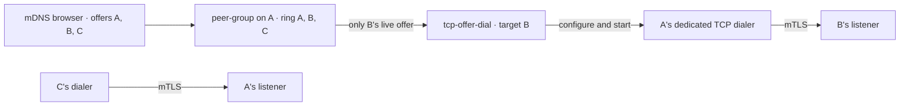

# Form a group from mDNS connection descriptions

[中文](README.zh-CN.md)

`go:peer-group` selects this host's neighbors and the dialer for each edge. Give every host the same ordered roster of public **offer IDs** and topology, then set `local` to its own entry. A member publishes that ID in its connection description. Membership comes from the roster. The TCP connector authenticates the destination with its locally configured TLS identity.

For a ring ordered `a, b, c`, all three hosts can see the same advertisements. On A, only B's offer reaches the dialing adapters. C initiates the other edge to A.



## Configure a host

The complete manifest runs A's listener, offer source, mDNS publisher and browser, group policy, and outgoing TCP adapter. [Ring manifest for A](example/ring-a.json)

| Setting | Value on A | Purpose |
| --- | --- | --- |
| Browser's `config.service` | `lan` | Publishes snapshots of the observed descriptions. |
| Group's `inject` and `config.source` | `["lan"]` and `lan` | Selects a trusted local observation service, already scoped to an interface and accepted kinds. |
| Group's `config` | `service: "neighbors", local: "a", members: ["a","b","c"], topology: "ring"` | Exposes only outbound offers selected for A. |
| TCP adapter's `inject` and `config.discovery` | Inject `neighbors` and the dedicated dial control, set `discovery` to `neighbors` | Each adapter keeps its target offer ID, permitted CIDRs and expected TLS name in local configuration. |

For B and C, change the host ID, local member, published ID, certificate paths and the successor's ID and expected TLS name. Keep the roster and its ordering identical across the hosts. Provision a dedicated adapter and dialer for each possible outbound peer whose credentials and endpoint policy you trust. A roster change can then activate a different adapter. The TCP listener supplies the other end of each edge. A missing adapter leaves its planned edge undialed.

Build the three Go binaries into each host's plugin directory from the repository root.

```sh
mkdir -p plugins/go
(cd group/peer && go build -o ../../plugins/go/peer-group ./cmd/peer-group)
(cd discovery/mdns && go build -o ../../plugins/go/discover-mdns ./cmd/discover-mdns)
(cd link/tcp && go build -o ../../plugins/go/link-tcp ./cmd/link-tcp)
```

Run `rutis-host run ring-a.json` in A's project directory using rutis-host 0.23.0. The example uses macOS `lo0` and separate identities signed by the group CA. For a physical LAN choose its multicast interface and publish a reachable ingress. The stock Go TCP listener binds to loopback. [mDNS publisher and connector setup](../../discovery/mdns/README.md)

## Select a topology

| `topology` | Neighbor and owner rule |
| --- | --- |
| `point-to-point` | Exactly two members. The first dials the second. |
| `chain` | Each member dials its successor, ending at the final member. |
| `ring` | At least three members. Each dials its successor, with the last dialing the first. |
| `star` | The first member is the hub. Each other member dials it. |
| `tree` | The first member is the root. Set `parents` to a child-to-parent mapping such as `{"b":"a","c":"a","d":"b"}`. Each non-root dials its parent. Unknown parents and cycles fail configuration. |
| `full-mesh` | Each pair uses the only reachable direction, or the lower case-sensitive ASCII ID if both can dial. If neither direction is available, the pair has an empty dialer. |
| `partial-mesh` | Supply priority-ordered undirected `edges`, for example `[["a","b"],["b","c"],["a","c"]]`, and a positive `maxNeighbors`. Use the mesh dial rule for each pair. Select a reachable edge only if **both** members have room. Every selected edge uses one slot at each end, inbound and outbound combined. |

For either mesh, `blockedDials: [["a","b"]]` declares that A cannot dial B. Undeclared directions are permitted. Reachability is shared deployment input. Receiving an advertisement on A provides no evidence of a reverse path from B. Partial-mesh slots are allocated to planned neighbors and stay reserved while their offers are absent. These slots bound group-selected edges. The listener controls admission and connection limits for incoming clients, including clients outside this group. Coordinate topology changes across hosts, especially changes to dial ownership.

## Observe the group

- `neighbors()` returns this host's planned edges as `{member, dialer}`. Read the connector's `status()` for the actual transport state.
- `snapshot()` and `waitForChange(cursor)` expose the mDNS snapshot contract. They retain the public parameters, provenance and expiry of each live outbound offer. Multiple live observations of the same `(id, kind, version)` suppress that choice until it becomes unique. Self, inbound-only peers and unknown members produce no dial candidates.
- A new group row gets a fresh cursor namespace. Source errors propagate. The TCP adapter stops its dedicated dialer on withdrawal, ambiguity or loss of the group service and can connect again after a valid offer returns. One subscription serves all local adapters. A change to the selected offers, including a lease refresh or expiry, advances the group cursor.

The integration test starts three distinct hosts, calls a remote RPC over every edge, withdraws and republishes an offer, and reverses the ring by changing only the group policies. Run from the repository root on macOS.

```sh
npm ci --prefix link/tcp/node
MDNS_TEST_INTERFACE=lo0 make integration-peer-group
```
