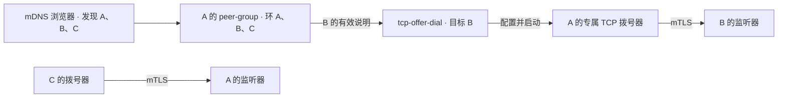

# 用 mDNS 连接说明组网

[English](README.md)

`go:peer-group` 决定本机有哪些邻居、每条边由谁拨号。各端配置同一份有序成员名单和拓扑，`local` 填本机对应的成员。名单使用发布方连接说明里的 **offer ID**。名单决定谁能参与组网，TCP 链接器用本机配置的 TLS 身份验证对端。

以顺序为 `a, b, c` 的环为例，三个 host 都可以发现全部公告。在 A 上，只有 B 的说明会交给拨号适配器。另一条边由 C 拨入 A。



## 配置到哪里

A 的完整清单包括监听器、说明来源、mDNS 发布与浏览、组网策略，以及出站 TCP 适配器。[A 的环形配置](example/ring-a.json)

| 配置位置 | A 上的值 | 用途 |
| --- | --- | --- |
| mDNS 浏览行的 `config.service` | `lan` | 提供原始发现快照。 |
| 组网行的 `inject` 和 `config.source` | `["lan"]` 和 `lan` | 读取本机指定的发现服务，网卡和可接受的说明类型由浏览行配置。 |
| 组网行的 `config` | `service: "neighbors", local: "a", members: ["a","b","c"], topology: "ring"` | 对外提供应由 A 主动拨号的候选说明。 |
| TCP 适配器的 `inject` 和 `config.discovery` | 注入 `neighbors` 和专属拨号控制服务，`discovery` 填 `neighbors` | 每个适配器在本地配置目标说明 ID、允许的地址范围和预期 TLS 名称。 |

配置 B 和 C 时，替换 host ID、本机成员名、发布的 ID、证书路径、后继的 ID 和预期 TLS 名称。各端的名单和顺序保持一致。对每个可能由本机拨出的邻居，预先配置一组具有相应准入策略的适配器与拨号器。之后改变拓扑即可启用另一组。缺少适配器的边只会出现在计划中。每条边的另一端由 TCP 监听器接入。

在仓库根目录构建三个 Go 程序，放到各 host 的插件目录。

```sh
mkdir -p plugins/go
(cd group/peer && go build -o ../../plugins/go/peer-group ./cmd/peer-group)
(cd discovery/mdns && go build -o ../../plugins/go/discover-mdns ./cmd/discover-mdns)
(cd link/tcp && go build -o ../../plugins/go/link-tcp ./cmd/link-tcp)
```

使用 rutis-host 0.23.0 在 A 的项目目录运行 `rutis-host run ring-a.json`。示例使用 macOS 的 `lo0`，每个 host 持有组内 CA 签发的独立证书。跨物理机部署应选择局域网组播网卡，并发布对端可达的入口。现有 Go TCP 监听器绑定回环地址。[mDNS 与链接器配置](../../discovery/mdns/README.zh-CN.md)

## 拓扑和拨号方向

| `topology` | 邻居和拨号方 |
| --- | --- |
| `point-to-point` | 恰好两名成员，第一名拨第二名。 |
| `chain` | 每个成员拨自己的后继，末尾成员只接收入站。 |
| `ring` | 至少三名成员，每人拨后继，末尾拨首位。 |
| `star` | 第一名是中心，其余成员主动拨中心。 |
| `tree` | 第一名是根。`parents` 配置子到父的映射，例如 `{"b":"a","c":"a","d":"b"}`。每个非根成员拨父节点。父节点未知或形成环时配置报错。 |
| `full-mesh` | 每对成员取可达方向。双向均可时，按区分大小写的 ASCII 顺序由较小 ID 拨号。双向均不可时，该对的拨号方为空。 |
| `partial-mesh` | `edges` 按优先级列出无向候选边，例如 `[["a","b"],["b","c"],["a","c"]]`，`maxNeighbors` 配正整数。每对成员沿用网状拨号规则。只有两端都还有名额才选边，每条边在两端各占一个名额，**入站和出站合计**。 |

两种网状拓扑都支持 `blockedDials: [["a","b"]]`，表示 A 无法拨 B。未列出的方向默认可拨。各端共享这份可达性配置，A 看见 B 的公告并不能推断出反向路径。部分网状按计划预留邻居名额，邻居暂时离线时也保留。这个上限约束组网插件选中的边，监听器负责实际入站准入和连接限额。各 host 应协调发布拓扑变更，特别是会切换拨号方的变更。

## 查看结果

- `neighbors()` 返回本机的邻接计划，格式为 `{member, dialer}`。实际是否连通可读链接器的 `status()`。
- `snapshot()` 和 `waitForChange(cursor)` 沿用 mDNS 快照接口，保留有效出站说明的公共参数、来源、接口和到期时间。同一 `(id, kind, version)` 同时有多个有效公告时，等到只剩一个才交付。本机、应拨入的邻居和名单外成员都不会成为出站候选。
- 组网行重载会更换游标，发现服务报错会传给调用方。说明撤回、出现歧义或组网服务下线时，TCP 适配器停止专属拨号器。有效说明恢复后可以重连。所有本机适配器共享一次发现订阅。选中说明的变化、租期刷新和到期都会推进组网游标。

集成测试启动三个真实 host，逐条边调用远端 RPC，撤回并重新发布公告，再只更新组网策略以反转整个环。在 macOS 上从仓库根目录运行。

```sh
npm ci --prefix link/tcp/node
MDNS_TEST_INTERFACE=lo0 node --test group/peer/test/ring.test.mjs
```
